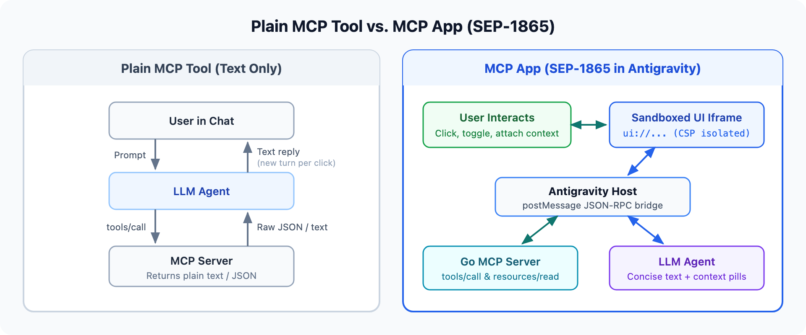
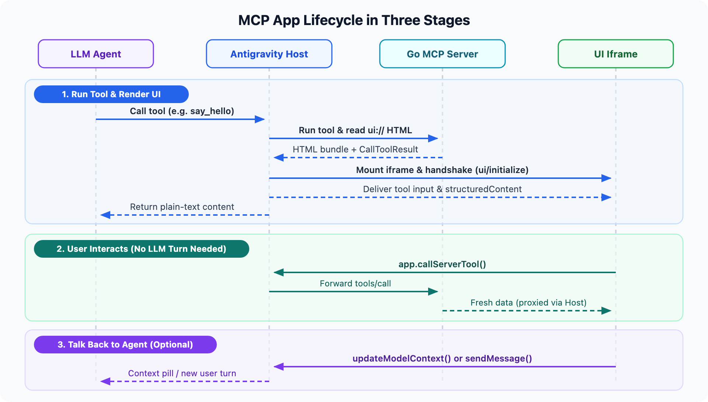

<!--
Suggested Titles:
1. Getting Started with MCP Apps and /mcp-app-development in Google Antigravity (in Go)
2. Building Interactive Tool UIs with MCP Apps, Go, and Google Antigravity
3. A Practical Introduction to MCP Apps (SEP-1865) Using Go and /mcp-app-development
-->

# Getting Started with MCP Apps and `/mcp-app-development` in Google Antigravity


*MCP Apps in Google Antigravity at a glance: how tools pair with ui:// views, what /mcp-app-development scaffolds, the two Go examples in this guide, and key rules to keep in mind.*

> **No prior MCP Apps experience required.** This guide walks through the basics of the MCP Apps specification (SEP-1865), how the `/mcp-app-development` command works in Google Antigravity, and how to build, test, and package two inline MCP Apps in **Go**—starting with a small Hello World card and expanding it into an interactive checklist.
>
> **Companion Repository:** All source code, tests, plugin manifests, and diagrams for this post live at [github.com/rominirani/antigravity-mcp-apps-guide](https://github.com/rominirani/antigravity-mcp-apps-guide).

```bash
git clone https://github.com/rominirani/antigravity-mcp-apps-guide.git
cd antigravity-mcp-apps-guide
```

---

## What We Will Cover

1. **[Why MCP Apps Exist](#1-why-mcp-apps-exist)** — Where text-only MCP tools run into friction, and how MCP Apps compare to plain tools and `/generative_ui`.
2. **[MCP Apps Basics (SEP-1865)](#2-mcp-apps-basics-sep-1865)** — Four core concepts: `ui://` resources, tool linkage, `content` vs. `structuredContent`, and the iframe `postMessage` bridge.
3. **[Using `/mcp-app-development` in Antigravity](#3-using-mcp-app-development-in-antigravity)** — What the slash command loads into the agent and how inline MCP Apps behave in Antigravity.
4. **[Example 1: Hello World in Go (`01-hello-world`)](#4-example-1-hello-world-in-go)** — One tool, one embedded `ui://` resource (`//go:embed`), host theming, and a button that calls back into your Go server.
5. **[Example 2: Interactive Quick Checklist (`02-quick-checklist`)](#5-example-2-interactive-quick-checklist)** — Adding app-only tools (`visibility: ["app"]`), persistent storage in `${PLUGIN_DATA}`, and attaching UI state to your next prompt with `app.updateModelContext()`.
6. **[Packaging & Iterating as an Antigravity Plugin](#6-packaging--iterating-as-an-antigravity-plugin)** — `plugin.json`, launching compiled Go binaries via `mcp_config.json`, `agy plugin validate --strict`, and reloading without restarting Antigravity.
7. **[Common Issues & Things to Try](#7-common-issues--things-to-try)** — A short troubleshooting table and a few small inline exercises to experiment with next.
8. **[Going Deeper: Suggested Reading Order](#8-going-deeper-suggested-reading-order)** — Where to read next, in order, to learn the rest of the MCP Apps standard and Antigravity's additional UI surfaces.

---

## 1. Why MCP Apps Exist

If you have used the [Model Context Protocol (MCP)](https://modelcontextprotocol.io), you know it lets AI agents call **tools** and read **resources** exposed by local or remote servers. By default, every tool returns text (or JSON text) into the chat.

Text works well for many tasks, but it becomes awkward whenever a human needs to inspect or manipulate data directly:

- Reading large JSON payloads or checklists in plain text clutters the conversation and spends context tokens on formatting.
- Small actions—like clicking a refresh button or checking off three items—shouldn't require a new LLM turn each time.
- Selecting specific items to send back to the agent is faster in a small interactive card than by copy-pasting text.

### MCP Tools vs. MCP Apps vs. `/generative_ui`

In Google Antigravity, you have three main ways to present tool output or interactive UIs to a user. Before writing code, it helps to separate them by two simple questions: **does the view need to talk to a live MCP server**, and **do you want to reuse it across conversations?**

- **Plain MCP Tools** are the right default when text output is enough—running a CLI check, fetching a short summary, or automating headless steps.
- **Generative UI (`/generative_ui`)** is useful when you want the model to sketch a one-off diagram, chart, or visual walkthrough on the fly for the current chat without standing up an MCP server.
- **MCP Apps (`/mcp-app-development`)** sit in the middle: deterministic, reusable UIs backed by a real MCP server that you can package and install as a plugin.

| Option | Backed by an MCP Server? | Reusable Across Chats? | Best Fit |
| :--- | :--- | :--- | :--- |
| **Plain MCP Tool** | Yes | Yes | Headless actions, CLI workflows, text summaries |
| **MCP App (`/mcp-app-development`)** | **Yes** | **Yes** (installable plugin) | Reusable interactive cards, checklists, viewers, and tool UIs backed by live server logic |
| **Generative UI (`/generative_ui`)** | No | Single conversation | One-off diagrams, charts, or quick prototypes generated on the spot |

The architectural difference between a plain MCP tool and an MCP App comes down to where the user interacts. With a plain tool, every follow-up action goes back through the LLM, which has to invoke the server again and rewrite the response. With an MCP App, Antigravity mounts a sandboxed HTML iframe that talks to your MCP server through the host over JSON-RPC—so clicks and toggles happen directly against the server, while the LLM receives a concise text summary (and any context the user explicitly chooses to attach):


*Figure 1: Plain-text MCP tools require a new LLM turn for every interaction, while MCP Apps render a sandboxed UI iframe that communicates with your server through the host.*

---

## 2. MCP Apps Basics (SEP-1865)

**MCP Apps** is an open extension to MCP ([SEP-1865](https://github.com/modelcontextprotocol/ext-apps/blob/main/specification/2026-01-26/apps.mdx), maintained in [`modelcontextprotocol/ext-apps`](https://github.com/modelcontextprotocol/ext-apps)). If a client doesn't support UI views—such as the Antigravity CLI (`agy`)—your tools still run normally and fall back to plain text.

Four concepts cover what you need to build your first MCP App:

1. **A `ui://` HTML resource linked from a tool**: Your MCP server exposes an HTML page at a `ui://` URI (with MIME type `text/html;profile=mcp-app`), and your tool points to it via `_meta.ui.resourceUri`. Keeping the HTML separate from the tool response lets the host load it on demand without bloating the chat history.
2. **Two outputs per tool call**: Return short plain text in `content` (read by the LLM and CLI clients) and JSON in `structuredContent` (rendered by the UI).
3. **An SDK-managed iframe bridge**: The host renders your HTML inside a sandboxed iframe and communicates with it over `postMessage`. Use the official `@modelcontextprotocol/ext-apps` package instead of writing that bridge by hand—it handles setup, resizing, and theme syncing automatically.
4. **One self-contained HTML file, with state on the server**: Because the sandbox blocks external scripts/fetches and discards `localStorage` when closed, bundle your JS and CSS into a single HTML file (for example with `esbuild`) and store any persistent state on your Go server. For Light/Dark styling, read the host's CSS theme variables (such as `--color-background-primary` and `--color-text-primary`) with fallback values.

Here is how those pieces fit together at runtime:


*Figure 2: The three stages of an MCP App lifecycle—initial render, direct UI-to-server callbacks, and optional messages or context updates back to the agent.*

> **One rule to remember:** Register your SDK event handlers (`ontoolinput`, `ontoolresult`, `onhostcontextchanged`) **before** calling `await app.connect()`, otherwise the iframe can miss the initial tool result.

---

## 3. Using `/mcp-app-development` in Antigravity

In the **Antigravity App** (`v2.34.0+`), `/mcp-app-development` is a built-in slash command backed by an Agent Skill. Prefixing your prompt with `/mcp-app-development` loads Antigravity's MCP Apps guidance into the agent's context from the first turn—covering the `ui://` resource contract, single-file bundling, host theming tokens, and plugin packaging.

In practice, you don't need to write MCP App boilerplate from scratch. You open an empty folder in the Antigravity App, run `/mcp-app-development` with a short description of what you want, and let the agent scaffold the server, UI bundle, tests, and plugin files for you. Both examples below start directly with that command and then walk through the generated code so you understand how every piece fits together.

### How Inline Views Behave in Antigravity

When a tool declares `_meta.ui.resourceUri` (without custom entrypoints), Antigravity replaces the collapsed tool step card directly in the conversation stream with your iframe. Inline cards start with a **150 px** fallback height (if no `size-changed` message arrives within 100 ms) and auto-resize up to **800 px** as your content grows; taller content scrolls inside the frame.

*(Note: Once you're comfortable with inline cards, Antigravity also supports side panels via `aux_pane`, full-page sidebar apps via `global`, and custom `file` viewers through `_meta["com.google.antigravity/ui"]`. We'll stick to inline cards here so you can focus on the core protocol first.)*

### Why Go Works Well for MCP Apps

Go pairs nicely with MCP Apps for local plugins:

1. **Official Go SDK**: [`github.com/modelcontextprotocol/go-sdk`](https://github.com/modelcontextprotocol/go-sdk) (`v1.8.0`) uses Go generics (`mcp.AddTool[In, Out]`) to infer JSON schemas from struct tags and automatically serialize your output struct into `structuredContent`.
2. **Single-binary deployment with `//go:embed`**: You can bundle your frontend once with `esbuild` into `dist/app.html` and embed it straight into your Go binary via `//go:embed dist/app.html`. Users don't need Node.js or Python installed at runtime to run your server.

---

## 4. Example 1: Hello World in Go

> **Companion Code:** [`go-examples/01-hello-world/`](https://github.com/rominirani/antigravity-mcp-apps-guide/tree/main/go-examples/01-hello-world)

Let's start with the simplest useful MCP App: **1 tool (`say_hello`)** and **1 embedded UI resource (`ui://hello-world/app.html`)**.

When the agent calls `say_hello(name="Ada")`, Antigravity renders a themed greeting card inline showing the server timestamp and call count. Clicking **Ping Server Again** inside the card calls `say_hello` directly back on the Go server via `app.callServerTool()`, updating the timestamp and count without another LLM turn.


*Figure 3: Go Example 1 embeds the single-file HTML UI into one Go binary and handles Ping Server Again callbacks via app.callServerTool().*

### Step 1: Scaffold the App with `/mcp-app-development`

Start by creating an empty folder (for example, `hello-mcp-app/`) and opening it as a project in the **Antigravity App**. Type `/` in the chat box, choose **`mcp-app-development`**, and run:

```text
/mcp-app-development Scaffold a minimal Go MCP App plugin using github.com/modelcontextprotocol/go-sdk and //go:embed: one inline say_hello(name?) tool returning a greeting, server timestamp, and call count, linked to ui://hello-world/app.html bundled into a single HTML file with esbuild and @modelcontextprotocol/ext-apps, themed with host CSS variables, with a "Ping Server Again" button calling say_hello via app.callServerTool(). Include a Go test, plugin.json, and mcp_config.json.
```

Antigravity uses the loaded skill to generate the Go server, the Vanilla JS frontend, the `esbuild` single-file bundler, the test file, and the plugin manifests. Your generated folder should look similar to the reference implementation in [`go-examples/01-hello-world/`](https://github.com/rominirani/antigravity-mcp-apps-guide/tree/main/go-examples/01-hello-world):

```text
go-examples/01-hello-world/
├── go.mod
├── main.go               # Go MCP server (~115 lines) with //go:embed dist/app.html
├── main_test.go          # In-memory MCP client/server test
├── ui/
│   ├── package.json      # @modelcontextprotocol/ext-apps + esbuild
│   ├── app.js            # Vanilla JS frontend (~55 lines)
│   └── build.mjs         # Bundles ui/app.js + CSS into ../dist/app.html
├── plugin.json           # Antigravity plugin manifest
├── mcp_config.json       # Launches the compiled Go binary
└── assets/logo.svg       # Plugin icon
```

### Step 2: What to Look For in `main.go`

You don't need to write the boilerplate from scratch—just open the generated `main.go` (full file: [`go-examples/01-hello-world/main.go`](https://github.com/rominirani/antigravity-mcp-apps-guide/blob/main/go-examples/01-hello-world/main.go)) and verify the three MCP Apps wiring points:

```go
//go:embed dist/app.html
var embeddedAppHTML string

// 1. Serve the bundled HTML as a ui:// resource with the MCP App MIME type.
server.AddResource(&mcp.Resource{
	URI:      "ui://hello-world/app.html",
	MIMEType: "text/html;profile=mcp-app",
}, readAppHTMLHandler)

// 2. Link say_hello to that resource via _meta.ui.resourceUri.
mcp.AddTool(server, &mcp.Tool{
	Name: "say_hello",
	Meta: mcp.Meta{"ui": map[string]any{"resourceUri": "ui://hello-world/app.html"}},
}, func(ctx context.Context, req *mcp.CallToolRequest, in HelloInput) (*mcp.CallToolResult, HelloOutput, error) {
	out := HelloOutput{Name: name, Greeting: greeting, ServerTime: now, PingCount: count}
	res := &mcp.CallToolResult{Content: []mcp.Content{&mcp.TextContent{Text: summary}}}
	return res, out, nil // Go SDK marshals `out` into structuredContent automatically
})
```

`CallToolResult.Content` provides the short plain-text fallback for the LLM and CLI clients, while the returned `HelloOutput` struct becomes `structuredContent` for the iframe.

### Step 3: What to Look For in `ui/app.js`

Similarly, in the generated frontend (full file: [`go-examples/01-hello-world/ui/app.js`](https://github.com/rominirani/antigravity-mcp-apps-guide/blob/main/go-examples/01-hello-world/ui/app.js)), the only MCP Apps–specific logic is connecting the `App` bridge in the right order:

```js
import { App, applyDocumentTheme, applyHostStyleVariables } from "@modelcontextprotocol/ext-apps";

const app = new App({ name: "Hello MCP App", version: "1.0.0" }, {});

// 1. Register handlers BEFORE calling app.connect().
app.ontoolresult = (result) => render(result?.structuredContent);
app.onhostcontextchanged = applyTheme;

// 2. Call back into the Go server directly on button click.
refreshBtn.addEventListener("click", async () => {
  const result = await app.callServerTool({ name: "say_hello", arguments: { name: currentName } });
  render(result?.structuredContent);
});

// 3. Complete the handshake and sync the host's light/dark theme.
await app.connect();
applyTheme(app.getHostContext());
```

In the full file, `render()` writes values with `textContent` (never `innerHTML`), hides the refresh button if `app.getHostCapabilities()?.serverTools` is absent, and [`ui/build.mjs`](https://github.com/rominirani/antigravity-mcp-apps-guide/blob/main/go-examples/01-hello-world/ui/build.mjs) uses `esbuild` to bundle everything into `dist/app.html`.

### Step 4: Build, Test & Try It in Antigravity

Because the iframe UI runs in the browser and imports `@modelcontextprotocol/ext-apps` from npm, `npm` is used once at **build time** to bundle `ui/app.js` and its CSS into `dist/app.html`. Once `go build` embeds that file into `scripts/hello-server`, Node.js is no longer needed at runtime.

```bash
cd go-examples/01-hello-world

# 1. Build-time only: bundle ui/app.js + @modelcontextprotocol/ext-apps into dist/app.html
npm --prefix ui install
npm --prefix ui run build

# 2. Test and compile the standalone Go binary (embeds dist/app.html)
go mod tidy
go test -v ./...
mkdir -p scripts && go build -o scripts/hello-server .

# 3. Validate and install the Antigravity plugin
agy plugin validate --strict .
agy plugin install .
```

Then open a chat in the **Antigravity App** and ask:

```text
Greet Ada using the say_hello tool.
```

You should see the inline greeting card appear directly in chat, and clicking **Ping Server Again** increments the server call counter without triggering another LLM turn.

**Verification Output:**

```text
Built .../go-examples/01-hello-world/dist/app.html (651.4 KiB)
=== RUN   TestHelloMCPApp
    main_test.go:58: UI resource verified: mimeType=text/html;profile=mcp-app size=667033 bytes
    main_test.go:84: Call #1 text: Hello, Ada! (Server time: 2026-11-26T06:40:09.268101Z, call #1)
    main_test.go:84: Call #2 text: Hello, Ada! (Server time: 2026-11-26T06:40:09.268281Z, call #2)
--- PASS: TestHelloMCPApp (0.04s)
PASS
ok  	example.com/hello-mcp-app	0.473s

Validating hello-mcp-app-go (plugin.json)
  skills 0 · agents 0 · rules 0 · hooks 0 · mcpServers 1 · sidecars 0
✔ Validation passed
```

---

## 5. Example 2: Interactive Quick Checklist

> **Companion Code:** [`go-examples/02-quick-checklist/`](https://github.com/rominirani/antigravity-mcp-apps-guide/tree/main/go-examples/02-quick-checklist)

Once Hello World makes sense, a natural next question is: *how do I build an inline UI that manages real state and feeds updates back into my conversation?*

Example 2 stays on the exact same stack (**Go + `//go:embed` + Vanilla JS**, still rendered inline in chat) and introduces just **three new concepts**:

1. **App-only tools (`visibility: ["app"]`)**: The model only sees `create_checklist`. Checking off items (`app_toggle_item`) and adding items (`app_add_item`) are marked with `_meta.ui.visibility: ["app"]`, keeping them hidden from the LLM while letting the iframe call them via `app.callServerTool()`.
2. **Eager server-side persistence in `${PLUGIN_DATA}`**: Because iframe `localStorage` is discarded on close and Antigravity does **not** send `ui/resource-teardown` before removing a view, every toggle or addition is written immediately to `${PLUGIN_DATA}/checklists.json` on the Go server.
3. **Attaching UI state to your next prompt (`app.updateModelContext()`)**: Clicking **Attach Remaining Items to Prompt** puts a context pill on your next chat message so the agent knows exactly which checklist items are done and which remain—only triggered on an explicit button click, and gated on `app.getHostCapabilities()?.updateModelContext`.


*Figure 4: Go Example 2 adds visibility:["app"] helper tools, eager persistence to PLUGIN_DATA, and prompt context pills via app.updateModelContext().*

### Step 1: Scaffold Quick Checklist with `/mcp-app-development`

Open a fresh folder (for example, `quick-checklist/`) in the **Antigravity App** and let `/mcp-app-development` generate the starter:

```text
/mcp-app-development Scaffold an inline Go MCP App plugin using github.com/modelcontextprotocol/go-sdk and //go:embed: expose create_checklist(title, items) to the model, hide app_toggle_item and app_add_item with visibility ["app"], persist checklists eagerly to PLUGIN_DATA/checklists.json, and add a Vanilla JS esbuild UI with a button that attaches remaining items via app.updateModelContext(). Include Go tests, plugin.json, and mcp_config.json.
```

Once Antigravity finishes scaffolding, walk through the two key pieces it generated (matching [`go-examples/02-quick-checklist/`](https://github.com/rominirani/antigravity-mcp-apps-guide/tree/main/go-examples/02-quick-checklist)).

### Step 2: Inspect the Generated Go Server (`main.go`)

In [`go-examples/02-quick-checklist/main.go`](https://github.com/rominirani/antigravity-mcp-apps-guide/blob/main/go-examples/02-quick-checklist/main.go), the model tool declares `resourceUri`, while the UI-only helper tools declare `visibility: ["app"]`:

```go
// Visible to the model: creates a checklist and opens the inline card.
mcp.AddTool(server, &mcp.Tool{
	Name:        "create_checklist",
	Title:       "Create Checklist",
	Description: "Create an interactive checklist rendered inline in the conversation.",
	Meta: mcp.Meta{
		"ui": map[string]any{"resourceUri": appURI},
	},
}, createHandler)

// Hidden from the model in UI hosts; callable only by the checklist iframe.
mcp.AddTool(server, &mcp.Tool{
	Name:        "app_toggle_item",
	Title:       "Toggle Checklist Item (App Only)",
	Description: "Toggle a checklist item's completion state from the checklist UI.",
	Meta: mcp.Meta{
		"ui": map[string]any{"visibility": []string{"app"}},
	},
}, toggleHandler)
```

On startup, `main()` reads `os.Getenv("PLUGIN_DATA")` (which Antigravity sets automatically to a writable per-plugin directory outside your workspace) and saves atomically via temp file + rename whenever an item is created, toggled, or added.

> **CLI note:** Non-UI clients like `agy` ignore `_meta.ui.visibility`, so still validate inputs (length caps, ID allowlists) on app-only tools just as you would on model-facing tools.

### Step 3: Inspect Context Attachment in the Frontend (`ui/app.js`)

In [`go-examples/02-quick-checklist/ui/app.js`](https://github.com/rominirani/antigravity-mcp-apps-guide/blob/main/go-examples/02-quick-checklist/ui/app.js), clicking **Attach Remaining Items to Prompt** calls `app.updateModelContext()` with plain text, and clicking **Clear Context** passes an empty `content` array:

```js
attachBtn.addEventListener("click", async () => {
  const remaining = (checklist.items || [])
    .filter((i) => !i.done)
    .map((i) => `- [ ] ${i.label}`);

  await app.updateModelContext({
    content: [
      {
        type: "text",
        text: `Checklist: ${checklist.title} (${checklist.doneCount}/${checklist.total} complete)\n` +
              (remaining.length ? `Remaining:\n${remaining.join("\n")}` : "All items complete."),
      },
    ],
  });
});

clearCtxBtn.addEventListener("click", async () => {
  await app.updateModelContext({ content: [] });
});
```

And right after `await app.connect()`, we gate the buttons so they stay hidden on any host or surface that does not support `updateModelContext`:

```js
const caps = app.getHostCapabilities();
if (!caps?.updateModelContext) {
  attachBtn.hidden = true;
  clearCtxBtn.hidden = true;
}
```

### Step 4: Build, Test & Try It in Antigravity

```bash
cd go-examples/02-quick-checklist

# 1. Build-time only: bundle the frontend UI into dist/app.html
npm --prefix ui install
npm --prefix ui run build

# 2. Test and compile the standalone Go binary (embeds dist/app.html)
go mod tidy
go test -v ./...
mkdir -p scripts && go build -o scripts/checklist-server .

# 3. Validate and install the Antigravity plugin
agy plugin validate --strict .
agy plugin install .
```

Then try it in an Antigravity App conversation:

```text
Create a PR review checklist for this repository using create_checklist.
```

Check off a couple of items in the inline card, click **Attach Remaining Items to Prompt**, and send a follow-up message—you will see the attached checklist summary appear as a context pill on your prompt.

**Verification Output:**

```text
Built .../go-examples/02-quick-checklist/dist/app.html (655.6 KiB)
=== RUN   TestQuickChecklistMCPApp
    main_test.go:59: UI resource verified: mimeType=text/html;profile=mcp-app size=671342 bytes
    main_test.go:89: Created:
        Checklist: PR Review Checklist (0/3 complete)
        - [ ] Run go test ./...
        - [ ] Check error handling
        - [ ] Verify plugin manifest
    main_test.go:122: After UI edits:
        Checklist: PR Review Checklist (1/4 complete)
        - [x] Run go test ./...
        - [ ] Check error handling
        - [ ] Verify plugin manifest
        - [ ] Update CHANGELOG.md
--- PASS: TestQuickChecklistMCPApp (0.04s)
PASS
ok  	example.com/quick-checklist-app	0.470s

Validating quick-checklist-go (plugin.json)
  skills 0 · agents 0 · rules 0 · hooks 0 · mcpServers 1 · sidecars 0
✔ Validation passed
```

---

## 6. Packaging & Iterating as an Antigravity Plugin

To load a local MCP App in Antigravity, package it as a plugin directory containing `plugin.json` and `mcp_config.json`.

### Launching a Compiled Go Binary in `mcp_config.json`

Here is a practical detail that catches many Go developers on their first plugin validation: **Antigravity expands `${PLUGIN_ROOT}` and `${PLUGIN_DATA}` in `args`, `env`, and `cwd`—not in `command`.**

If you put `"command": "${PLUGIN_ROOT}/scripts/hello-server"`, `agy plugin validate --strict` flags a warning. Instead, invoke the binary via `"command": "env"` with the binary path in `args` (and place binaries in `scripts/` so executable `0755` permissions are preserved):

```json
{
  "mcpServers": {
    "hello": {
      "command": "env",
      "args": ["${PLUGIN_ROOT}/scripts/hello-server"]
    }
  }
}
```

Also avoid duplicating `PLUGIN_ROOT` or `PLUGIN_DATA` inside `"env"`; Antigravity exports both environment variables into every plugin MCP server process automatically.

### Validate & Install Locally

```bash
# Validate manifest, assets, and mcp_config.json strictly
agy plugin validate --strict ./go-examples/01-hello-world
agy plugin validate --strict ./go-examples/02-quick-checklist

# Install into your local Antigravity environment
agy plugin install ./go-examples/01-hello-world
agy plugin install ./go-examples/02-quick-checklist
```

### Fast Iteration Loop

- **Editing HTML/JS/CSS**: Re-run `npm --prefix ui run build` and point `HELLO_APP_HTML` or `CHECKLIST_APP_HTML` at `dist/app.html` while iterating. Closing and reopening the view fetches the updated HTML immediately without recompiling Go or restarting the server.
- **Editing Go server code**: Recompile (`go build -o scripts/hello-server .`), then restart the server either from **Customizations > Installed > \<plugin\> > MCP > More actions (`⋮`) > Restart**, or from an Antigravity terminal using the Language Server RPC (plugin servers are namespaced `<plugin-name>_<server-key>`):

```bash
curl -sf -H "Content-Type: application/json" \
  -H "x-codeium-csrf-token: ${ANTIGRAVITY_CSRF_TOKEN}" \
  -d '{"serverName": "hello-mcp-app-go_hello"}' \
  "http://${ANTIGRAVITY_LS_ADDRESS:-localhost:5387}/exa.language_server_pb.LanguageServerService/RefreshMcpServers"
```

---

## 7. Common Issues & Things to Try

### Quick Debugging Checklist

| Symptom | Likely Cause | Fix |
| :--- | :--- | :--- |
| **Error card instead of UI** | Wrong MIME type, empty HTML, or HTML > 10 MiB. | Return `text/html;profile=mcp-app` and register the resource with `server.AddResource`. |
| **Blank iframe** | `app.connect()` failed, or external scripts/styles were blocked by default-deny CSP. | Bundle JS and CSS inline with `esbuild` so the HTML makes no external requests. |
| **Card shows loading text forever** | `ontoolresult` was registered after `await app.connect()`. | Register `ontoolinput`, `ontoolresult`, and `onhostcontextchanged` before calling `app.connect()`. |
| **App-only `callServerTool()` fails** | Tool lacks `"app"` in `visibility`, belongs to another server, or > 4 calls are in flight. | Set `_meta.ui.visibility: ["app"]` (or omit `visibility`) and keep calls on the owning server. |
| **Colors look wrong after Light/Dark toggle** | Host variables were only applied once on startup. | Call `applyDocumentTheme()` and `applyHostStyleVariables()` both after `connect()` and inside `onhostcontextchanged`. |
| **`agy plugin validate --strict` warns on `command`** | `${PLUGIN_ROOT}` was placed in `command` instead of `args`. | Use `"command": "env"` and `"args": ["${PLUGIN_ROOT}/scripts/<binary>"]`. |

### Things to Try Next

1. **Add a delete button to Quick Checklist**: Expose a third app-only tool (`app_delete_item`) in [`go-examples/02-quick-checklist/main.go`](https://github.com/rominirani/antigravity-mcp-apps-guide/blob/main/go-examples/02-quick-checklist/main.go) and wire a remove button next to each checklist item.
2. **Send a follow-up prompt directly from the card**: Add a **Ask Agent About Remaining Items** button that calls `app.sendMessage({ role: "user", content: [{ type: "text", text: ... }] })` (gated on `app.getHostCapabilities()?.message`).
3. **Add a Go build-info or environment card**: Clone `01-hello-world` and have the Go tool report `runtime.Version()`, `runtime.GOOS`, and `go.mod` module dependencies inside a searchable inline table.
4. **Let `/mcp-app-development` scaffold a new inline tool**:
   ```text
   /mcp-app-development Build an inline Go MCP App plugin using github.com/modelcontextprotocol/go-sdk and //go:embed that formats and validates a cron expression, showing the next 5 run times and letting me edit the expression live via an app-only tool.
   ```

---

## 8. Going Deeper: Suggested Reading Order

We have only scratched the surface of the MCP Apps standard here—sticking to inline cards, single-file bundling, `visibility: ["app"]` helpers, and `app.updateModelContext()`. Beyond these basics, the standard covers streaming partial tool inputs, custom CSP and CORS domains, OAuth-backed remote servers, display modes, and Antigravity's side-panel, full-page, and custom file-viewer surfaces.

If you want to learn the full standard systematically, read the official documentation in this order:

### Step 1: Core Concepts & Official Quickstart

Start here to reinforce the mental model and see how the spec presents MCP Apps across hosts (Claude, ChatGPT, VS Code, and Antigravity):

1. **[MCP Apps Overview (`modelcontextprotocol.io`)](https://modelcontextprotocol.io/extensions/apps/overview)** — High-level introduction to why the extension exists, how hosts render views, and how graceful fallback works.
2. **[Build an MCP App (`modelcontextprotocol.io`)](https://modelcontextprotocol.io/extensions/apps/build)** & **[Official Quickstart (`docs/quickstart.md`)](https://github.com/modelcontextprotocol/ext-apps/blob/main/docs/quickstart.md)** — The official end-to-end starter walkthrough from the `ext-apps` maintainers.

### Step 2: Practical App Patterns, Security & Testing

Once you have built one or two small inline apps, read these guides before shipping anything larger:

3. **[Common Patterns (`docs/patterns.md`)](https://github.com/modelcontextprotocol/ext-apps/blob/main/docs/patterns.md)** — How to structure chunked loading, polling, streaming partial tool arguments (`ontoolinputpartial`), and state persistence.
4. **[CSP & CORS Guide (`docs/csp-cors.md`)](https://github.com/modelcontextprotocol/ext-apps/blob/main/docs/csp-cors.md)** — How iframe sandbox origins work, when (and when not) to allowlist `connectDomains` or `resourceDomains`, and why server-side `tools/call` is usually safer.
5. **[Testing MCP Apps (`docs/testing-mcp-apps.md`)](https://github.com/modelcontextprotocol/ext-apps/blob/main/docs/testing-mcp-apps.md)** & **[Official Examples Gallery (`ext-apps/examples`)](https://github.com/modelcontextprotocol/ext-apps/tree/main/examples)** — How to run the reference `basic-host` locally and browse working examples in React, Vue, Svelte, Vanilla JS, and Python.
6. **[Authorization (`docs/authorization.md`)](https://github.com/modelcontextprotocol/ext-apps/blob/main/docs/authorization.md)** — Moving from local `stdio` servers to authenticated remote Streamable HTTP MCP App servers.

### Step 3: Google Antigravity Surfaces & Plugin Packaging

When you are ready to go beyond inline cards inside Antigravity:

7. **[Google Antigravity — MCP Apps](https://antigravity.google/docs/mcp-apps)** — Covers Antigravity's `com.google.antigravity/ui` extensions: side panel tabs (`aux_pane`), full-page sidebar views (`global`), custom file viewers and editors (`file` / `antigravity-file://`), opening workspace files (`toggle-aux-pane`), background conversations, and exact host limits.
8. **[Google Antigravity — Build Plugins](https://antigravity.google/docs/build-plugins)** & **[`/mcp-app-development` Command](https://antigravity.google/docs/commands/mcp-app-development)** — Packaging MCP Apps alongside skills, rules, and hooks, validating with `agy plugin validate --strict`, and distributing plugins.

### Step 4: The Formal Specification & SDK References

Keep these bookmarked when you need exact wire schemas, method signatures, or error codes:

9. **[SEP-1865 Formal Specification (`specification/2026-01-26/apps.mdx`)](https://github.com/modelcontextprotocol/ext-apps/blob/main/specification/2026-01-26/apps.mdx)** — The normative JSON-RPC 2.0 specification for every message, notification, capability flag, and display mode.
10. **[`@modelcontextprotocol/ext-apps` API Reference](https://apps.extensions.modelcontextprotocol.io/api/)** (and **[Migrating to v2](https://github.com/modelcontextprotocol/ext-apps/blob/main/docs/migrate-to-2.md)**) — Complete frontend SDK reference for `App`, React hooks, theming helpers, and `downloadFile()`.
11. **[MCP Go SDK (`pkg.go.dev/github.com/modelcontextprotocol/go-sdk/mcp`)](https://pkg.go.dev/github.com/modelcontextprotocol/go-sdk/mcp)** — Go API docs for `AddTool`, `AddResource`, `Meta`, `StructuredContent`, and transports.

> **More examples in this repository:** If you want to explore side panels (`aux_pane`), full-page (`global`) views, and custom file viewers (`.archmap`) right away, the [companion GitHub repository](https://github.com/rominirani/antigravity-mcp-apps-guide) also includes an extended multi-surface guide ([`TUTORIAL.md`](https://github.com/rominirani/antigravity-mcp-apps-guide/blob/main/TUTORIAL.md)) with additional Python and TypeScript examples under [`examples/`](https://github.com/rominirani/antigravity-mcp-apps-guide/tree/main/examples).
