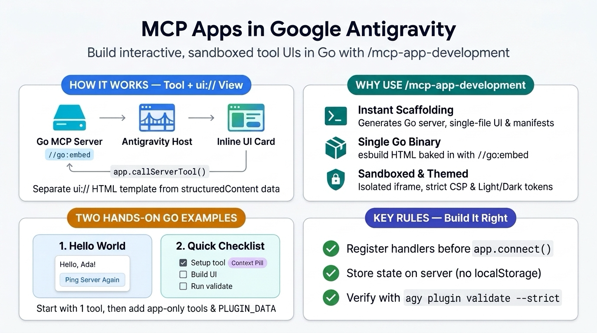
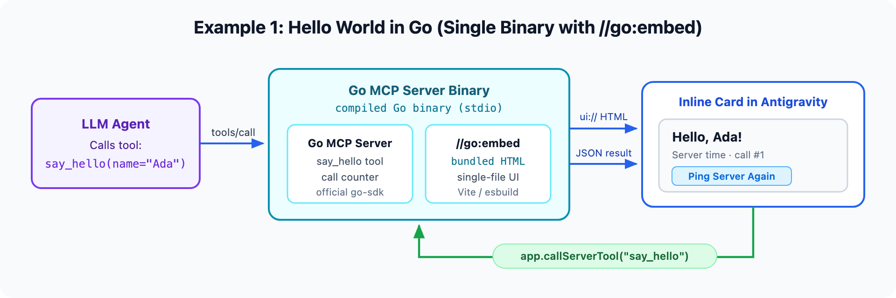
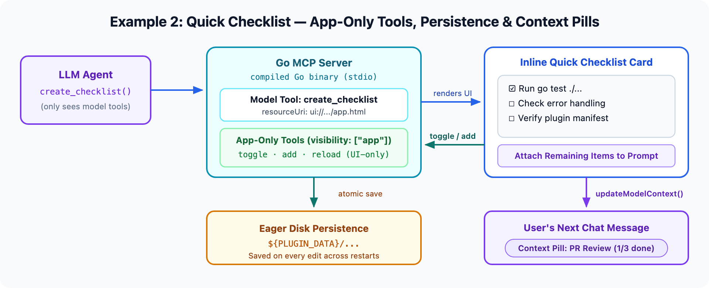

<!--
Suggested Titles:
1. Getting Started with MCP Apps and /mcp-app-development in Google Antigravity (in Go)
2. Building Interactive Tool UIs with MCP Apps, Go, and Google Antigravity
3. A Practical Introduction to MCP Apps (SEP-1865) Using Go and /mcp-app-development
-->

# Getting Started with MCP Apps and `/mcp-app-development` in Google Antigravity


*MCP Apps in Google Antigravity at a glance: how tools pair with ui:// views, what /mcp-app-development scaffolds, the two Go examples in this guide, and key rules to keep in mind.*

> **No prior MCP Apps experience required.** This guide walks through the basics of the MCP Apps specification (SEP-1865), how the `/mcp-app-development` command works in Google Antigravity, and how to build, test, and package two inline MCP Apps in **Go**—starting with a small Hello World card and expanding it into an interactive checklist.
>
> **Companion Repository:** All source code, tests, plugin manifests, and diagrams for this post live at [github.com/rominirani/antigravity-mcp-apps-guide](https://github.com/rominirani/antigravity-mcp-apps-guide).

```bash
git clone https://github.com/rominirani/antigravity-mcp-apps-guide.git
cd antigravity-mcp-apps-guide
```

---

## What We Will Cover

1. **[Why MCP Apps Exist](#1-why-mcp-apps-exist)** — Where text-only MCP tools run into friction, and how MCP Apps compare to plain tools and `/generative_ui`.
2. **[MCP Apps Basics](#2-mcp-apps-basics)** — The four-part mental model behind every MCP App.
3. **[Using `/mcp-app-development` in Antigravity](#3-using-mcp-app-development-in-antigravity)** — How the slash command scaffolds an MCP App for you, and why Go is a nice fit.
4. **[Example 1: Hello World in Go (`01-hello-world`)](#4-example-1-hello-world-in-go)** — Scaffolding your first inline greeting card with a live button that calls back into your Go server.
5. **[Example 2: Interactive Quick Checklist (`02-quick-checklist`)](#5-example-2-interactive-quick-checklist)** — Adding UI-only actions, server-side persistence, and a button that attaches checklist progress to your next prompt.
6. **[Packaging & Iterating as an Antigravity Plugin](#6-packaging--iterating-as-an-antigravity-plugin)** — One Go-specific plugin config tip and a quick edit-rebuild loop.
7. **[Common Issues & Things to Try](#7-common-issues--things-to-try)** — A short troubleshooting table and a few small ideas to experiment with next.
8. **[Going Deeper: Suggested Reading Order](#8-going-deeper-suggested-reading-order)** — Where to read next, in order, when you are ready to explore the rest of the MCP Apps standard.

---

## 1. Why MCP Apps Exist

If you have used the [Model Context Protocol (MCP)](https://modelcontextprotocol.io), you know it lets AI agents call **tools** and read **resources** exposed by local or remote servers. By default, every tool returns text (or JSON text) into the chat.

Text works well for many tasks, but it becomes awkward whenever a human needs to inspect or manipulate data directly:

- Reading large JSON payloads or checklists in plain text clutters the conversation and spends context tokens on formatting.
- Small actions—like clicking a refresh button or checking off three items—shouldn't require a new LLM turn each time.
- Selecting specific items to send back to the agent is faster in a small interactive card than by copy-pasting text.

### MCP Tools vs. MCP Apps vs. `/generative_ui`

In Google Antigravity, you have three main ways to present tool output or interactive UIs to a user. Before writing code, it helps to separate them by two simple questions: **does the view need to talk to a live MCP server**, and **do you want to reuse it across conversations?**

- **Plain MCP Tools** are the right default when text output is enough—running a CLI check, fetching a short summary, or automating headless steps.
- **Generative UI (`/generative_ui`)** is useful when you want the model to sketch a one-off diagram, chart, or visual walkthrough on the fly for the current chat without standing up an MCP server.
- **MCP Apps (`/mcp-app-development`)** sit in the middle: deterministic, reusable UIs backed by a real MCP server that you can package and install as a plugin.

| Option | Backed by an MCP Server? | Reusable Across Chats? | Best Fit |
| :--- | :--- | :--- | :--- |
| **Plain MCP Tool** | Yes | Yes | Headless actions, CLI workflows, text summaries |
| **MCP App (`/mcp-app-development`)** | **Yes** | **Yes** (installable plugin) | Reusable interactive cards, checklists, viewers, and tool UIs backed by live server logic |
| **Generative UI (`/generative_ui`)** | No | Single conversation | One-off diagrams, charts, or quick prototypes generated on the spot |

The architectural difference between a plain MCP tool and an MCP App comes down to where the user interacts. With a plain tool, every follow-up action goes back through the LLM, which has to invoke the server again and rewrite the response. With an MCP App, Antigravity mounts a sandboxed HTML iframe that talks to your MCP server through the host—so clicks and toggles happen directly against the server, while the LLM receives a concise text summary (and any context the user explicitly chooses to attach):


*Figure 1: Plain-text MCP tools require a new LLM turn for every interaction, while MCP Apps render a sandboxed UI iframe that communicates with your server through the host.*

---

## 2. MCP Apps Basics

**MCP Apps** is an open extension to MCP ([SEP-1865](https://github.com/modelcontextprotocol/ext-apps/blob/main/specification/2026-01-26/apps.mdx), maintained in [`modelcontextprotocol/ext-apps`](https://github.com/modelcontextprotocol/ext-apps)). If a client doesn't support UI views—such as the Antigravity CLI (`agy`)—your tools still run normally and fall back to plain text.

When you use `/mcp-app-development`, Antigravity handles the wire-level details for you. You only need a high-level mental model of four moving parts:

1. **The UI lives separately from tool output**: Your MCP server exposes an HTML page at a `ui://` URI and links your tool to it. Antigravity loads that HTML on demand, so UI markup never clutters the chat history.
2. **Every tool call returns text for the model and data for the UI**: Plain text goes to the LLM (and CLI clients like `agy`), while structured JSON goes straight to the interactive card.
3. **The UI runs in a sandboxed iframe**: Using the official `@modelcontextprotocol/ext-apps` helper library, the card receives tool results, matches Antigravity's Light/Dark theme, and can call tools back on your MCP server without starting another LLM turn.
4. **Bundle into one HTML file, and keep state on the server**: Because the sandbox blocks external network scripts and discards browser storage when closed, the frontend is bundled into a single HTML file and any persistent state lives on your server.

Here is how those pieces interact at runtime:


*Figure 2: The three stages of an MCP App lifecycle—initial render, direct UI-to-server callbacks, and optional messages or context updates back to the agent.*

---

## 3. Using `/mcp-app-development` in Antigravity

In the **Antigravity App** (`v2.34.0+`), `/mcp-app-development` is a built-in slash command backed by an Agent Skill. Prefixing your prompt with `/mcp-app-development` loads Antigravity's MCP Apps guidance into the agent's context—so you can describe *what* you want to build in plain language while the agent handles the protocol details, single-file bundling, Light/Dark theming, and plugin files.

By default, an MCP App renders **inline** right inside the chat stream in place of a collapsed tool card and automatically resizes to fit its content. *(Antigravity also supports side panels, full-page sidebar apps, and custom file viewers—links to those are in Section 8 once you're comfortable with inline cards.)*

### Why Go Works Well for MCP Apps

Go is a clean fit for local MCP App plugins:

1. **Official Go SDK**: [`github.com/modelcontextprotocol/go-sdk`](https://github.com/modelcontextprotocol/go-sdk) infers tool input schemas straight from Go structs and automatically serializes your output struct for the UI.
2. **Single-binary packaging with `//go:embed`**: Once the frontend is bundled into `dist/app.html`, `//go:embed dist/app.html` bakes it into your compiled Go binary—so users don't need Node.js or Python installed at runtime.

---

## 4. Example 1: Hello World in Go

> **Companion Code:** [`go-examples/01-hello-world/`](https://github.com/rominirani/antigravity-mcp-apps-guide/tree/main/go-examples/01-hello-world)

Let's start with the simplest useful MCP App: **1 tool (`say_hello`)** and **1 embedded UI resource (`ui://hello-world/app.html`)**.

When the agent calls `say_hello(name="Ada")`, Antigravity renders a themed greeting card inline showing the server timestamp and call count. Clicking **Ping Server Again** inside the card calls `say_hello` directly on the Go server, updating the timestamp and count without another LLM turn.


*Figure 3: Go Example 1 embeds the single-file HTML UI into one Go binary and handles Ping Server Again callbacks via app.callServerTool().*

### Step 1: Scaffold the App with `/mcp-app-development`

Start by creating an empty folder (for example, `hello-mcp-app/`) and opening it as a project in the **Antigravity App**. Type `/` in the chat box, choose **`mcp-app-development`**, and describe what you want in plain language:

```text
/mcp-app-development Build a simple Hello World MCP App in Go packaged as an Antigravity plugin. Add a say_hello tool that takes an optional name and renders an inline greeting card showing the server time, a call counter, and a "Ping Server Again" button that refreshes from the server.
```

Notice you don't need to mention `ui://` URIs, MIME types, bundlers, or plugin manifest keys—the `/mcp-app-development` skill supplies those conventions automatically. Your generated file names or frontend bundler may differ slightly from the reference project in [`go-examples/01-hello-world/`](https://github.com/rominirani/antigravity-mcp-apps-guide/tree/main/go-examples/01-hello-world), which is completely fine—the MCP Apps wiring underneath is the same:

```text
go-examples/01-hello-world/
├── go.mod
├── main.go               # Go MCP server (~115 lines) with //go:embed dist/app.html
├── main_test.go          # In-memory MCP client/server test
├── ui/
│   ├── package.json      # @modelcontextprotocol/ext-apps + esbuild
│   ├── app.js            # Vanilla JS frontend (~55 lines)
│   └── build.mjs         # Bundles ui/app.js + CSS into ../dist/app.html
├── plugin.json           # Antigravity plugin manifest
├── mcp_config.json       # Launches the compiled Go binary
└── assets/logo.svg       # Plugin icon
```

### Step 2: What to Look For in `main.go`

You don't need to write the boilerplate from scratch—just open the generated `main.go` (full file: [`go-examples/01-hello-world/main.go`](https://github.com/rominirani/antigravity-mcp-apps-guide/blob/main/go-examples/01-hello-world/main.go)) and verify the three MCP Apps wiring points:

```go
//go:embed dist/app.html
var embeddedAppHTML string

// 1. Serve the bundled HTML as a ui:// resource with the MCP App MIME type.
server.AddResource(&mcp.Resource{
	URI:      "ui://hello-world/app.html",
	MIMEType: "text/html;profile=mcp-app",
}, readAppHTMLHandler)

// 2. Link say_hello to that resource via _meta.ui.resourceUri.
mcp.AddTool(server, &mcp.Tool{
	Name: "say_hello",
	Meta: mcp.Meta{"ui": map[string]any{"resourceUri": "ui://hello-world/app.html"}},
}, func(ctx context.Context, req *mcp.CallToolRequest, in HelloInput) (*mcp.CallToolResult, HelloOutput, error) {
	out := HelloOutput{Name: name, Greeting: greeting, ServerTime: now, PingCount: count}
	res := &mcp.CallToolResult{Content: []mcp.Content{&mcp.TextContent{Text: summary}}}
	return res, out, nil // Go SDK marshals `out` into structuredContent automatically
})
```

`CallToolResult.Content` provides the short plain-text fallback for the LLM and CLI clients, while the returned `HelloOutput` struct becomes `structuredContent` for the iframe.

### Step 3: What to Look For in `ui/app.js`

Similarly, in the generated frontend (full file: [`go-examples/01-hello-world/ui/app.js`](https://github.com/rominirani/antigravity-mcp-apps-guide/blob/main/go-examples/01-hello-world/ui/app.js)), the only MCP Apps–specific logic is connecting the `App` bridge in the right order:

```js
import { App, applyDocumentTheme, applyHostStyleVariables } from "@modelcontextprotocol/ext-apps";

const app = new App({ name: "Hello MCP App", version: "1.0.0" }, {});

// 1. Register handlers BEFORE calling app.connect().
app.ontoolresult = (result) => render(result?.structuredContent);
app.onhostcontextchanged = applyTheme;

// 2. Call back into the Go server directly on button click.
refreshBtn.addEventListener("click", async () => {
  const result = await app.callServerTool({ name: "say_hello", arguments: { name: currentName } });
  render(result?.structuredContent);
});

// 3. Complete the handshake and sync the host's light/dark theme.
await app.connect();
applyTheme(app.getHostContext());
```

In the full file, `render()` writes values safely with `textContent` (never `innerHTML`), hides the refresh button if a host doesn't support tool callbacks, and [`ui/build.mjs`](https://github.com/rominirani/antigravity-mcp-apps-guide/blob/main/go-examples/01-hello-world/ui/build.mjs) uses `esbuild` to bundle everything into `dist/app.html`.

### Step 4: Build, Test & Try It in Antigravity

Because the iframe UI runs in the browser and imports `@modelcontextprotocol/ext-apps` from npm, `npm` is used once at **build time** to bundle `ui/app.js` and its CSS into `dist/app.html`. Once `go build` embeds that file into `scripts/hello-server`, Node.js is no longer needed at runtime.

```bash
cd go-examples/01-hello-world

# 1. Build-time only: bundle ui/app.js + @modelcontextprotocol/ext-apps into dist/app.html
npm --prefix ui install
npm --prefix ui run build

# 2. Test and compile the standalone Go binary (embeds dist/app.html)
go mod tidy
go test -v ./...
mkdir -p scripts && go build -o scripts/hello-server .

# 3. Validate and install the Antigravity plugin
agy plugin validate --strict .
agy plugin install .
```

You should see the Go test pass (`PASS`) and plugin validation print `✔ Validation passed`. Then open a chat in the **Antigravity App** and ask:

```text
Greet Ada using the say_hello tool.
```

You should see the inline greeting card appear directly in chat, and clicking **Ping Server Again** increments the server call counter without triggering another LLM turn.

---

## 5. Example 2: Interactive Quick Checklist

> **Companion Code:** [`go-examples/02-quick-checklist/`](https://github.com/rominirani/antigravity-mcp-apps-guide/tree/main/go-examples/02-quick-checklist)

Once Hello World makes sense, a natural next question is: *how do I build an inline UI that manages real state and feeds updates back into my conversation?*

Example 2 stays on the same **Go + `//go:embed`** stack and adds **three capabilities**:

1. **UI-only tools (`visibility: ["app"]`)**: The model only sees `create_checklist`. Toggling or adding items stays hidden from the model while remaining callable directly from the card.
2. **Server-side persistence (`PLUGIN_DATA`)**: Because browser storage in the iframe isn't permanent, the Go server writes every change immediately to Antigravity's per-plugin data directory (`PLUGIN_DATA`).
3. **Attaching UI state to your next prompt (`updateModelContext`)**: Clicking **Attach Remaining Items to Prompt** puts a context pill on your next chat message so the agent knows which checklist items are done and which remain.


*Figure 4: Go Example 2 adds visibility:["app"] helper tools, eager persistence to PLUGIN_DATA, and prompt context pills via app.updateModelContext().*

### Step 1: Scaffold Quick Checklist with `/mcp-app-development`

Open a fresh folder (for example, `quick-checklist/`) in the **Antigravity App** and describe the app naturally:

```text
/mcp-app-development Build an inline checklist MCP App in Go packaged as an Antigravity plugin. Let the agent create a checklist with a title and items; inside the card, let me check off items, add new ones, keep my progress across restarts, and click a button to attach the remaining items to my next chat prompt.
```

Once Antigravity finishes scaffolding, walk through the two key additions it generated (full reference: [`go-examples/02-quick-checklist/`](https://github.com/rominirani/antigravity-mcp-apps-guide/tree/main/go-examples/02-quick-checklist)).

### Step 2: What to Look For in `main.go`

In [`go-examples/02-quick-checklist/main.go`](https://github.com/rominirani/antigravity-mcp-apps-guide/blob/main/go-examples/02-quick-checklist/main.go), the model-facing tool points to `resourceUri`, while the UI-only helper tools set `visibility: ["app"]`:

```go
// Visible to the model: creates a checklist and opens the inline card.
mcp.AddTool(server, &mcp.Tool{
	Name: "create_checklist",
	Meta: mcp.Meta{"ui": map[string]any{"resourceUri": appURI}},
}, createHandler)

// Hidden from the model in UI hosts; callable only from the checklist card.
mcp.AddTool(server, &mcp.Tool{
	Name: "app_toggle_item",
	Meta: mcp.Meta{"ui": map[string]any{"visibility": []string{"app"}}},
}, toggleHandler)
```

On startup, `main()` reads `os.Getenv("PLUGIN_DATA")` (set automatically by Antigravity to a writable folder outside your workspace) and persists every edit to `checklists.json` immediately.

### Step 3: What to Look For in `ui/app.js`

In [`go-examples/02-quick-checklist/ui/app.js`](https://github.com/rominirani/antigravity-mcp-apps-guide/blob/main/go-examples/02-quick-checklist/ui/app.js), clicking **Attach Remaining Items to Prompt** calls `app.updateModelContext()` with a plain-text summary (and clicking **Clear Context** passes an empty `content` array). The button is hidden automatically if the host doesn't advertise context support:

```js
attachBtn.addEventListener("click", async () => {
  const remaining = checklist.items.filter((i) => !i.done).map((i) => `- [ ] ${i.label}`);

  await app.updateModelContext({
    content: [
      {
        type: "text",
        text: `Checklist: ${checklist.title} (${checklist.doneCount}/${checklist.total} complete)\n` +
              (remaining.length ? `Remaining:\n${remaining.join("\n")}` : "All items complete."),
      },
    ],
  });
});

clearCtxBtn.addEventListener("click", () => app.updateModelContext({ content: [] }));
```

### Step 4: Build, Test & Try It in Antigravity

```bash
cd go-examples/02-quick-checklist

# 1. Build-time only: bundle the frontend UI into dist/app.html
npm --prefix ui install
npm --prefix ui run build

# 2. Test and compile the standalone Go binary (embeds dist/app.html)
go mod tidy
go test -v ./...
mkdir -p scripts && go build -o scripts/checklist-server .

# 3. Validate and install the Antigravity plugin
agy plugin validate --strict .
agy plugin install .
```

Then try it in an Antigravity App conversation:

```text
Create a PR review checklist for this repository using create_checklist.
```

Check off a couple of items in the inline card, click **Attach Remaining Items to Prompt**, and send a follow-up message—you will see the attached checklist summary appear as a context pill on your prompt.

---

## 6. Packaging & Iterating as an Antigravity Plugin

`/mcp-app-development` generates `plugin.json` and `mcp_config.json` for you, and `agy plugin validate --strict .` checks them before install. Below are the one Go-specific config quirk to watch for and a quick loop for iterating on changes.

### Launching a Compiled Go Binary in `mcp_config.json`

Antigravity expands `${PLUGIN_ROOT}` and `${PLUGIN_DATA}` inside `args`, `env`, and `cwd`—not inside `command`. If you put `"command": "${PLUGIN_ROOT}/scripts/hello-server"`, `agy plugin validate --strict` flags a warning. Invoke the binary via `"command": "env"` instead (and place binaries under `scripts/` so executable permissions are preserved):

```json
{
  "mcpServers": {
    "hello": {
      "command": "env",
      "args": ["${PLUGIN_ROOT}/scripts/hello-server"]
    }
  }
}
```

### Quick Edit-Rebuild Loop

- **Editing HTML/JS/CSS**: Re-run `npm --prefix ui run build`. If you set `HELLO_APP_HTML` (or `CHECKLIST_APP_HTML`) to point at `dist/app.html` during development, closing and reopening the card picks up the updated UI without recompiling Go or restarting the server.
- **Editing Go server code**: Recompile (`go build -o scripts/hello-server .`), then restart the server from **Customizations > Installed > \<plugin\> > MCP > More actions (`⋮`) > Restart** in the Antigravity App.

---

## 7. Common Issues & Things to Try

### Quick Debugging Checklist

| Symptom | Likely Cause | Fix |
| :--- | :--- | :--- |
| **Error card instead of UI** | Wrong MIME type or missing UI resource. | Return `text/html;profile=mcp-app` from `server.AddResource`. |
| **Blank iframe** | `app.connect()` failed, or external scripts/styles were blocked by the sandbox. | Bundle JS and CSS inline into one HTML file (`dist/app.html`). |
| **Card stays stuck on "Connecting..."** | Event handlers were registered after `await app.connect()`. | Register `ontoolresult` and `onhostcontextchanged` before `app.connect()`. |
| **Button callback fails** | Tool is hidden from the UI or belongs to another server. | Set `visibility: ["app"]` (or omit `visibility`) on the same MCP server. |
| **Colors look wrong after Light/Dark toggle** | Host theme was only applied once at startup. | Apply host theme both after `connect()` and inside `onhostcontextchanged`. |
| **`agy plugin validate --strict` warns on `command`** | `${PLUGIN_ROOT}` was placed in `command` instead of `args`. | Use `"command": "env"` and `"args": ["${PLUGIN_ROOT}/scripts/<binary>"]`. |

### Things to Try Next

1. **Add a delete button to Quick Checklist**: Ask `/mcp-app-development` to add an app-only delete action to [`go-examples/02-quick-checklist/`](https://github.com/rominirani/antigravity-mcp-apps-guide/tree/main/go-examples/02-quick-checklist) with a remove button next to each item.
2. **Send a follow-up prompt directly from the card**: Add an **Ask Agent About Remaining Items** button that uses `app.sendMessage()` to start a follow-up turn straight from the UI.
3. **Build a Go environment card**: Start from `01-hello-world` and show `runtime.Version()`, `runtime.GOOS`, and `go.mod` dependencies inside a searchable inline table.
4. **Scaffold a brand-new inline app**:
   ```text
   /mcp-app-development Build an inline Go MCP App plugin that validates a cron expression, shows the next 5 run times, and lets me edit the expression live inside the card.
   ```

---

## 8. Going Deeper: Suggested Reading Order

We have only scratched the surface of the MCP Apps standard here—sticking to inline cards, single-file bundling, `visibility: ["app"]` helpers, and `app.updateModelContext()`. Beyond these basics, the standard covers streaming partial tool inputs, custom CSP and CORS domains, OAuth-backed remote servers, display modes, and Antigravity's side-panel, full-page, and custom file-viewer surfaces.

If you want to learn the full standard systematically, read the official documentation in this order:

### Step 1: Core Concepts & Official Quickstart

Start here to reinforce the mental model and see how the spec presents MCP Apps across hosts (Claude, ChatGPT, VS Code, and Antigravity):

1. **[MCP Apps Overview (`modelcontextprotocol.io`)](https://modelcontextprotocol.io/extensions/apps/overview)** — High-level introduction to why the extension exists, how hosts render views, and how graceful fallback works.
2. **[Build an MCP App (`modelcontextprotocol.io`)](https://modelcontextprotocol.io/extensions/apps/build)** & **[Official Quickstart (`docs/quickstart.md`)](https://github.com/modelcontextprotocol/ext-apps/blob/main/docs/quickstart.md)** — The official end-to-end starter walkthrough from the `ext-apps` maintainers.

### Step 2: Practical App Patterns, Security & Testing

Once you have built one or two small inline apps, read these guides before shipping anything larger:

3. **[Common Patterns (`docs/patterns.md`)](https://github.com/modelcontextprotocol/ext-apps/blob/main/docs/patterns.md)** — How to structure chunked loading, polling, streaming partial tool arguments (`ontoolinputpartial`), and state persistence.
4. **[CSP & CORS Guide (`docs/csp-cors.md`)](https://github.com/modelcontextprotocol/ext-apps/blob/main/docs/csp-cors.md)** — How iframe sandbox origins work, when (and when not) to allowlist `connectDomains` or `resourceDomains`, and why server-side `tools/call` is usually safer.
5. **[Testing MCP Apps (`docs/testing-mcp-apps.md`)](https://github.com/modelcontextprotocol/ext-apps/blob/main/docs/testing-mcp-apps.md)** & **[Official Examples Gallery (`ext-apps/examples`)](https://github.com/modelcontextprotocol/ext-apps/tree/main/examples)** — How to run the reference `basic-host` locally and browse working examples in React, Vue, Svelte, Vanilla JS, and Python.
6. **[Authorization (`docs/authorization.md`)](https://github.com/modelcontextprotocol/ext-apps/blob/main/docs/authorization.md)** — Moving from local `stdio` servers to authenticated remote Streamable HTTP MCP App servers.

### Step 3: Google Antigravity Surfaces & Plugin Packaging

When you are ready to go beyond inline cards inside Antigravity:

7. **[Google Antigravity — MCP Apps](https://antigravity.google/docs/mcp-apps)** — Covers Antigravity's extra UI surfaces (side panel tabs, full-page sidebar views, and custom file viewers), background conversations, and exact host limits.
8. **[Google Antigravity — Build Plugins](https://antigravity.google/docs/build-plugins)** & **[`/mcp-app-development` Command](https://antigravity.google/docs/commands/mcp-app-development)** — Packaging MCP Apps alongside skills, rules, and hooks, validating with `agy plugin validate --strict`, and distributing plugins.

### Step 4: The Formal Specification & SDK References

Keep these bookmarked when you need exact wire schemas, method signatures, or error codes:

9. **[SEP-1865 Formal Specification (`specification/2026-01-26/apps.mdx`)](https://github.com/modelcontextprotocol/ext-apps/blob/main/specification/2026-01-26/apps.mdx)** — The normative JSON-RPC 2.0 specification for every message, notification, capability flag, and display mode.
10. **[`@modelcontextprotocol/ext-apps` API Reference](https://apps.extensions.modelcontextprotocol.io/api/)** (and **[Migrating to v2](https://github.com/modelcontextprotocol/ext-apps/blob/main/docs/migrate-to-2.md)**) — Complete frontend SDK reference for `App`, React hooks, theming helpers, and `downloadFile()`.
11. **[MCP Go SDK (`pkg.go.dev/github.com/modelcontextprotocol/go-sdk/mcp`)](https://pkg.go.dev/github.com/modelcontextprotocol/go-sdk/mcp)** — Go API docs for `AddTool`, `AddResource`, `Meta`, `StructuredContent`, and transports.

> **More examples in this repository:** If you want to explore side panels (`aux_pane`), full-page (`global`) views, and custom file viewers (`.archmap`) right away, the [companion GitHub repository](https://github.com/rominirani/antigravity-mcp-apps-guide) also includes an extended multi-surface guide ([`TUTORIAL.md`](https://github.com/rominirani/antigravity-mcp-apps-guide/blob/main/TUTORIAL.md)) with additional Python and TypeScript examples under [`examples/`](https://github.com/rominirani/antigravity-mcp-apps-guide/tree/main/examples).
