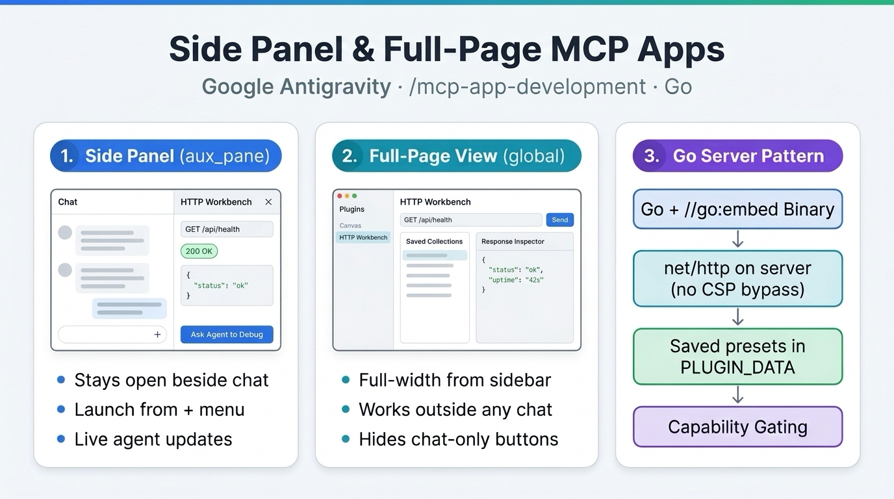
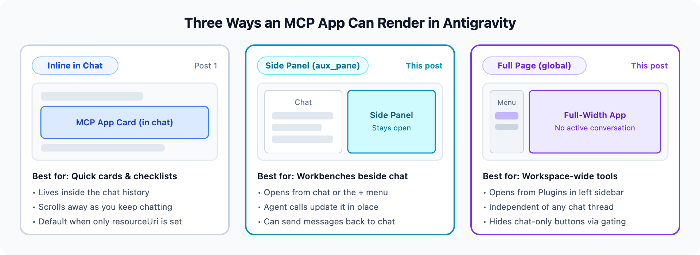
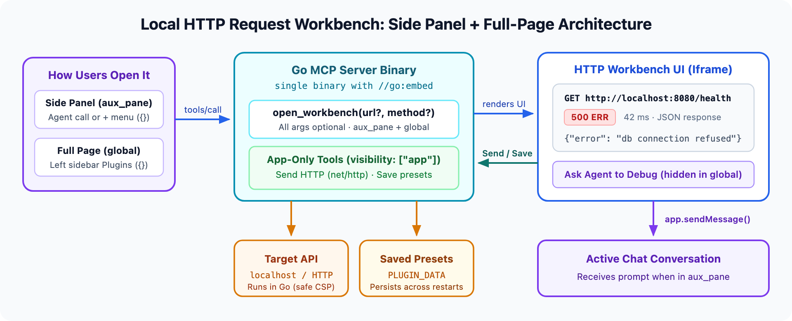

<!--
Suggested Titles:
1. Beyond Inline Cards: Side Panel and Full-Page MCP Apps in Google Antigravity
2. Building Side Panel and Full-Page MCP Apps in Go with /mcp-app-development
3. Taking MCP Apps Further in Google Antigravity: Side Panels, Full-Page Views, and Capability Gating
-->

# Beyond Inline Cards: Side Panel and Full-Page MCP Apps in Google Antigravity


*Moving MCP Apps out of the chat stream: opening a Go-backed HTTP Request Workbench in the Antigravity side panel beside chat, and full-width from the left sidebar.*

> **Building on Post 1:** In the [first post](<POST_1_URL>), we covered MCP Apps basics and used `/mcp-app-development` to scaffold two **inline** Go apps that render right inside chat messages. Here, we take the next step—moving out of the chat stream into **Side Panel** and **Full-Page** views by building a **Local HTTP Request Workbench** in Go.

---

## What We Will Cover

1. **[When Inline Cards Aren't Enough](#1-when-inline-cards-arent-enough)** — How Side Panel (`aux_pane`) and Full-Page (`global`) views differ from inline cards.
2. **[What We're Building: A Local HTTP Request Workbench](#2-what-were-building-a-local-http-request-workbench)** — Why routing HTTP requests through Go is both cleaner and safer than browser `fetch()`.
3. **[Building the Side Panel View (`aux_pane`)](#3-building-the-side-panel-view-aux_pane)** — Scaffolding with `/mcp-app-development`, handling empty `+` menu launches, and sending debug prompts back to chat.
4. **[Adding a Full-Page Sidebar View (`global`) & Capability Gating](#4-adding-a-full-page-sidebar-view-global--capability-gating)** — Opening the same workbench full-width from the left sidebar and hiding chat-only buttons cleanly.
5. **[Common Side Panel & Full-Page Issues](#5-common-side-panel--full-page-issues)** — A short troubleshooting checklist.
6. **[What's Next](#6-whats-next)** — Where we'll go in the next post (Custom File Viewers and Companion Skills) and official docs.

---

## 1. When Inline Cards Aren't Enough

Inline cards are great for quick greetings, small forms, or short checklists. Once you keep chatting, though, an inline card scrolls up and out of sight.

Google Antigravity adds two extra surfaces for tools that deserve more breathing room:

- **Side Panel (`aux_pane`)**: Opens beside your conversation and stays put while you chat. You can open it yourself from the side panel's **`+`** menu, or let the agent open it for you—and if the agent calls the same tool again, Antigravity updates the open panel in place instead of spawning duplicates.
- **Full-Page View (`global`)**: Opens full-width from **Plugins** in the left sidebar, completely independent of any conversation. It's ideal when you want wide tables, saved collections, or a workspace-level tool without starting a chat first.

| Surface | Where It Lives | How It Opens | Best Fit |
| :--- | :--- | :--- | :--- |
| **Inline in Chat** | Inside a chat message | Agent calls a tool with `resourceUri` | Quick cards, small checklists, single-step results |
| **Side Panel (`aux_pane`)** | Docked beside your active chat | Agent calls the tool, or user clicks **`+`** in the side panel | Workbenches, inspectors, and boards you use alongside chat |
| **Full Page (`global`)** | Full-width workspace view | User opens it from **Plugins** in the left sidebar | Wide dashboards, saved collections, standalone utilities |

Here is how the three layouts compare visually:


*Figure 1: Inline cards live inside chat history, Side Panels stay open beside your conversation, and Full-Page views open full-width from the left sidebar.*

---

## 2. What We're Building: A Local HTTP Request Workbench

To see why Side Panel and Full-Page views are so useful, let's build a lightweight Postman-style **Local HTTP Request Workbench** in Go.

Inside the workbench, you can:
- Pick an HTTP method (`GET`, `POST`, `PUT`, `DELETE`), enter a URL (such as `http://localhost:8080/health`), add headers or a JSON body, and send the request.
- Inspect the status code, response time, headers, and pretty-printed JSON response.
- Save named request presets to disk (`PLUGIN_DATA`) so they survive restarts.
- Click **"Ask Agent to Debug"** whenever a request fails (for example a `500` error), dropping the request details and error response right into your active chat.

### Why Sending Requests from Go Matters Here

Remember from Post 1 that MCP App iframes run inside a locked-down sandbox that blocks browser `fetch()` calls by default. Rather than poking holes in the sandbox's security rules, our UI asks the **Go MCP server** to run the request using Go's standard `net/http` client and return the result. That keeps the iframe locked down, avoids browser CORS headaches on `localhost`, and gives you a clean, auditable server boundary.


*Figure 2: The HTTP Workbench opens in either the Side Panel or Full-Page view, runs HTTP requests through Go's net/http server, stores saved presets in PLUGIN_DATA, and sends failed responses to chat via app.sendMessage().*

### Prerequisites

Just like Post 1, make sure **Antigravity App (`v2.34.0+`)**, the **`agy` CLI**, **Go (`1.24+`)**, and **Node.js (`20+`) / `npm`** (used at build time to bundle the UI into one HTML file) are installed on your machine.

---

## 3. Building the Side Panel View (`aux_pane`)

### Step 1: Scaffold with `/mcp-app-development`

Create an empty folder (for example, `http-workbench/`) and open it as a project in the **Antigravity App**. Type `/`, select **`mcp-app-development`**, and describe what you want in plain language:

```text
/mcp-app-development Build a Local HTTP Request Workbench MCP App in Go packaged as an Antigravity plugin that opens in the side panel. Let me pick an HTTP method, URL, headers, and JSON body, send requests through the Go server, save named request presets across restarts, view formatted responses with status code and timing, and click an "Ask Agent to Debug" button when a request fails.
```

Antigravity will scaffold the Go server, single-file frontend bundle, tests, `plugin.json`, and `mcp_config.json`—and typically builds, tests, and validates the project as it goes.

### Step 2: What to Verify in the Generated Go Server

Exact file names and folder layout will vary from run to run. Open the generated Go server code and check three things that make a Side Panel MCP App work cleanly:

```go
// 1. Add an aux_pane entrypoint alongside resourceUri so it opens in the side panel.
mcp.AddTool(server, &mcp.Tool{
	Name: "open_workbench",
	Meta: mcp.Meta{
		"ui": map[string]any{"resourceUri": appURI},
		"com.google.antigravity/ui": map[string]any{
			"entrypoints": []map[string]any{
				{"type": "aux_pane", "title": "HTTP Workbench"},
			},
		},
	},
}, openWorkbenchHandler)

// 2. Keep the actual HTTP execution & preset saving as UI-only tools.
mcp.AddTool(server, &mcp.Tool{
	Name: "app_send_request",
	Meta: mcp.Meta{"ui": map[string]any{"visibility": []string{"app"}}},
}, sendRequestHandler)
```

- **Make every argument optional on `open_workbench`**: When a user opens your panel manually from the **`+`** menu, Antigravity calls the tool with empty `{}` arguments. Returning your saved presets and a clean default URL when no arguments are passed prevents startup errors.
- **No inline rendering**: Once a tool declares an `aux_pane` entrypoint, Antigravity automatically opens it in the side panel instead of inline in chat. Calling `open_workbench` again later (for example, with a new URL) updates the already-open tab in place.
- **Server-side HTTP + persistence**: `app_send_request` runs `net/http` with a sensible timeout in Go, and saved presets write immediately to `PLUGIN_DATA`.

### Step 3: What to Verify in the Generated Frontend

Inside the generated frontend code, check the two main bridge calls:

```ts
// 1. Run HTTP requests through your Go server (not browser fetch).
sendBtn.addEventListener("click", async () => {
  const res = await app.callServerTool({
    name: "app_send_request",
    arguments: { method, url, headers, body },
  });
  renderResponse(res.structuredContent);
});

// 2. Send a failing response straight into the active chat conversation.
debugBtn.addEventListener("click", async () => {
  await app.sendMessage({
    role: "user",
    content: [{ type: "text", text: formatDebugPrompt(lastRequest, lastResponse) }],
  });
});
```

Notice the difference from Post 1's `app.updateModelContext()`:
- `updateModelContext()` quietly attaches a context pill to whatever message the user types next.
- **`app.sendMessage()`** immediately sends a user message into the active chat so the agent starts helping right away—which fits a button like **Ask Agent to Debug**.

### Step 4: Validate, Install & Try the Side Panel

From your project folder, run:

```bash
agy plugin validate --strict .
agy plugin install .
```

Now try opening the workbench in **two different ways** inside the Antigravity App:

1. **From the `+` menu**: Click **`+`** in the side panel and select **HTTP Workbench**. It opens immediately with your empty/default view (zero chat messages needed).
2. **From chat**: Ask the agent:
   ```text
   Open the HTTP Workbench to test GET https://httpbin.org/status/500
   ```
   Run the request in the panel, see the `500` status appear, and click **Ask Agent to Debug**—your request and response details are sent right into the conversation.

*(Tip: If you don't have a local server running on `localhost`, `https://httpbin.org/get` and `https://httpbin.org/status/500` are handy test endpoints.)*

---

## 4. Adding a Full-Page Sidebar View (`global`) & Capability Gating

Side panels are great while chatting, but sometimes you want the entire window—for example, to organize a dozen saved API presets or read a large JSON payload without cramping it into a narrow pane.

The nice part about Antigravity's entrypoint model is that you don't need a second app or a second UI bundle. You just add a `global` entrypoint to the same tool and handle one small difference.

### Step 1: Ask `/mcp-app-development` to Add the Full-Page View

Stay in your `http-workbench/` project folder and run a follow-up prompt:

```text
/mcp-app-development Add a full-page sidebar view to this HTTP Workbench plugin so I can also open it from Plugins in the left sidebar. Hide the "Ask Agent to Debug" button when opened full-page outside a conversation.
```

### Step 2: The Two Small Changes That Make It Work

1. **On the Go server**, `entrypoints` now lists both surfaces on the same tool:

```go
"com.google.antigravity/ui": map[string]any{
	"entrypoints": []map[string]any{
		{"type": "aux_pane", "title": "HTTP Workbench"},
		{"type": "global", "title": "HTTP Workbench"},
	},
},
```

2. **In the frontend**, check **host capabilities** right after `await app.connect()`:

```ts
await app.connect();

// A global sidebar view has no active conversation, so `message` is omitted.
const caps = app.getHostCapabilities();
if (!caps?.message) {
  debugBtn.hidden = true;
}
```

This pattern is called **capability gating**. Because a `global` view lives outside any conversation, Antigravity omits conversation-only capabilities like `message` and `updateModelContext`. Checking `app.getHostCapabilities()` lets one single UI adapt cleanly wherever it is opened—showing **Ask Agent to Debug** in the Side Panel and hiding it in the Full-Page view instead of leaving a dead button behind.

### Step 3: Rebuild, Reinstall & Try Full-Page

Rebuild if Antigravity didn't already recompile for you, then validate, reinstall, and restart the plugin server:

```bash
agy plugin validate --strict .
agy plugin install .
```

Open **Plugins** in Antigravity's left sidebar and click **HTTP Workbench**. You'll see the exact same Go-backed workbench fill the full window, with all your saved presets intact and the chat-only **Ask Agent to Debug** button cleanly hidden.

---

## 5. Common Side Panel & Full-Page Issues

| Symptom | Likely Cause | Fix |
| :--- | :--- | :--- |
| **Opening from `+` or sidebar shows an error** | Your tool rejected empty `{}` arguments. | Make every input parameter optional and return a clean default view when `{}` is passed. |
| **Tool still renders inline instead of the side panel** | `com.google.antigravity/ui.entrypoints` is missing or misspelled. | Add `{"type": "aux_pane", "title": "..."}` under `_meta["com.google.antigravity/ui"]`. |
| **Plugin doesn't appear in `+` menu or left sidebar** | Entrypoint is on a tool without `resourceUri`, or the server hasn't restarted. | Ensure the same tool declares both `resourceUri` and `entrypoints`, then restart the MCP server under **Customizations > Installed**. |
| **"Ask Agent to Debug" button does nothing in full-page** | `global` views have no owning conversation. | Hide chat-only buttons when `!app.getHostCapabilities()?.message`. |
| **HTTP request fails with CSP / network error** | The UI called browser `fetch()` directly instead of the Go server. | Route HTTP calls through an app-only Go tool (`net/http`) via `app.callServerTool()`. |

---

## 6. What's Next

You now have one Go MCP App running across **both** the Side Panel and the Full-Page sidebar, executing real work on the server and adapting cleanly to each surface's capabilities.

In the next post, we'll explore Antigravity's remaining surface—**Custom File Viewers (`file`)**—by building a structured **`.jsonl` Log Explorer** in Go that opens automatically whenever you click a `.jsonl` file, jumps straight to referenced source files in a side tab, and bundles a **Companion Skill** inside the same plugin.

### Helpful Links

- **[Google Antigravity — MCP Apps](https://antigravity.google/docs/mcp-apps)** — Reference for `aux_pane`, `global`, and `file` entrypoints.
- **[Google Antigravity — Side Panel and Overview Panel](https://antigravity.google/docs/side-panel)** — Working with side panel tabs and **Plugins** menus.
- **[MCP Apps Specification (SEP-1865)](https://github.com/modelcontextprotocol/ext-apps/blob/main/specification/2026-01-26/apps.mdx)** — Full protocol details for `sendMessage` and host capabilities.
