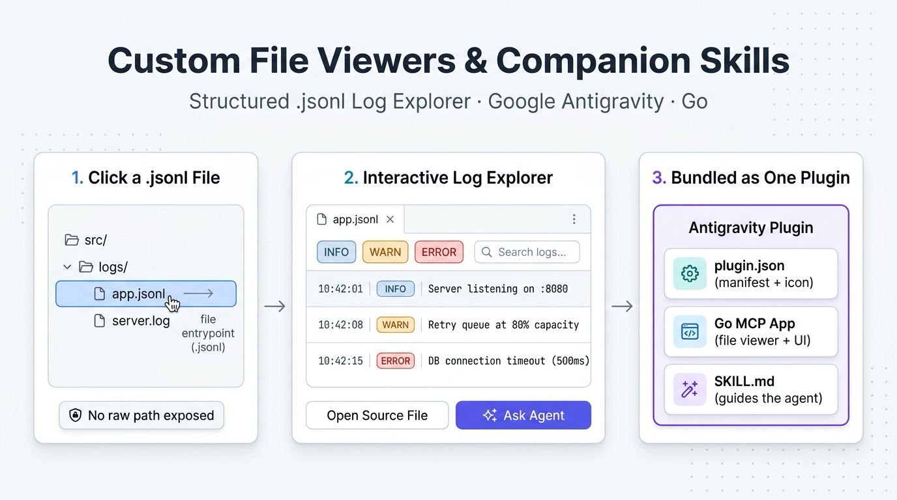
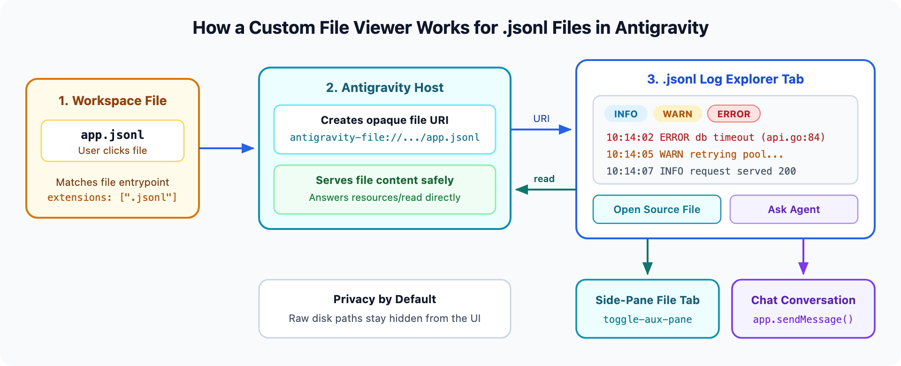
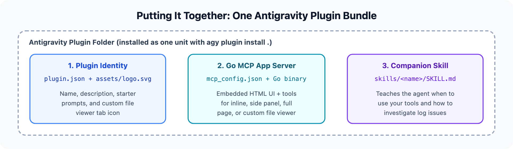

<!--
Suggested Titles:
1. Custom File Viewers and Companion Skills for MCP Apps in Google Antigravity
2. Building a .jsonl Log Explorer File Viewer in Go with /mcp-app-development
3. Opening Custom File Types with MCP Apps and Skills in Google Antigravity
-->

# Custom File Viewers and Companion Skills for MCP Apps in Google Antigravity


*Turning raw .jsonl files into an interactive Log Explorer tab in Google Antigravity—and bundling a companion Skill in the same Go plugin.*

> **Building on Posts 1 & 2:** So far, we've built [inline chat cards](<POST_1_URL>) and [Side Panel / Full-Page workbenches](<POST_2_URL>) in Go using `/mcp-app-development`. In this post, we explore the final MCP App surface in Google Antigravity—**Custom File Viewers (`file`)**—by building a **`.jsonl` Log Explorer**, jumping straight to referenced source files, and pairing the app with a **Companion Skill** inside the same plugin.

---

## What We Will Cover

1. **[Why Custom File Viewers Exist](#1-why-custom-file-viewers-exist)** — How Antigravity lets an MCP App replace the plain-text viewer for specific file extensions.
2. **[How Antigravity's `file` Entrypoint Works](#2-how-antigravitys-file-entrypoint-works)** — Opaque `antigravity-file://` URIs and privacy-by-default file reading.
3. **[Building the `.jsonl` Log Explorer](#3-building-the-jsonl-log-explorer)** — Scaffolding with `/mcp-app-development`, reading the opened file, jumping to source code, and asking the agent to investigate errors.
4. **[Pairing Your MCP App with a Companion Skill](#4-pairing-your-mcp-app-with-a-companion-skill)** — Adding a `SKILL.md` to the same plugin so the agent knows how to help triage log issues.
5. **[Common Custom File Viewer Issues](#5-common-custom-file-viewer-issues)** — Quick troubleshooting tips.
6. **[Wrapping Up & Where to Go Next](#6-wrapping-up--where-to-go-next)** — Summary across all four Antigravity surfaces and official docs.

---

## 1. Why Custom File Viewers Exist

Some files are meant for machines first and humans second. Structured log files (`.jsonl` or `.ndjson`, where each line is a separate JSON object) are a classic example: opening one in a standard text editor gives you walls of dense, single-line JSON that are tedious to scan when you're hunting down an error.

With a **Custom File Viewer (`file`)**, you can tell Google Antigravity: *whenever I click a `.jsonl` or `.ndjson` file in my project, open my MCP App instead of plain text.* You get level filters (`INFO`, `WARN`, `ERROR`), instant search, expandable JSON fields, and one-click actions to jump to source code or ask the agent to investigate.

---

## 2. How Antigravity's `file` Entrypoint Works

Custom file viewers follow a simple, privacy-friendly flow:

1. **Your Go tool claims one or more extensions**: You add a `file` entrypoint listing extensions like `[".jsonl", ".ndjson"]`. Antigravity automatically hides file-viewer tools from the LLM (so they never clutter the model's tool list) and uses your plugin's logo as the tab icon.
2. **Antigravity passes an opaque URI—not a raw disk path**: When you click `app.jsonl`, Antigravity launches your viewer with a temporary URI like `antigravity-file://<id>/app.jsonl`. Your UI never needs direct filesystem access or raw host paths.
3. **Your UI reads the file contents directly from Antigravity**: The frontend calls `app.readServerResource({ uri })` with that opaque URI, and Antigravity hands back the file contents straight to the iframe (up to 10 MiB).

Here is how those steps connect:


*Figure 1: Clicking a .jsonl file triggers the file entrypoint with an opaque antigravity-file:// URI; the Log Explorer reads it via resources/read and can open referenced source files or message the agent.*

---

## 3. Building the `.jsonl` Log Explorer

### Step 1: Scaffold with `/mcp-app-development`

Create an empty folder (for example, `jsonl-log-explorer/`) and open it as a project in the **Antigravity App**. Type `/`, choose **`mcp-app-development`**, and describe the viewer in plain language:

```text
/mcp-app-development Build a structured .jsonl and .ndjson log explorer MCP App in Go packaged as an Antigravity plugin. Register it as a custom file viewer using Antigravity's file entrypoint so clicking a .jsonl file reads the opaque antigravity-file:// resource, parses each JSON line, and lets me filter by log level (INFO, WARN, ERROR), search messages, expand fields, open any referenced source file in a side-pane tab, and click "Ask Agent to Investigate" on an error row.
```

Antigravity will scaffold the Go server, single-file frontend bundle, tests, `plugin.json`, `assets/logo.svg`, and `mcp_config.json`.

### Step 2: What to Verify in the Generated Go Server

Open the generated Go server code and verify how the file viewer tool is declared:

```go
// Register a custom file viewer for .jsonl and .ndjson files.
mcp.AddTool(server, &mcp.Tool{
	Name: "open_jsonl_file",
	Meta: mcp.Meta{
		"ui": map[string]any{"resourceUri": appURI},
		"com.google.antigravity/ui": map[string]any{
			"entrypoints": []map[string]any{
				{
					"type":       "file",
					"title":      "JSONL Log Explorer",
					"extensions": []string{".jsonl", ".ndjson"},
				},
			},
		},
	},
}, openFileHandler)
```

When you click a `.jsonl` file, Antigravity invokes `open_jsonl_file` with `{"file": {"name": "app.jsonl", "resourceUri": "antigravity-file://..."}}`. The Go handler simply returns that `file` object in `structuredContent` (plus a short text summary in `Content`) so the iframe knows which URI to read.

### Step 3: What to Verify in the Generated Frontend

In the generated frontend code, check three pieces:

**1. Reading the opened file via `app.readServerResource()`:**

```ts
// Antigravity intercepts antigravity-file:// URIs and returns the file as base64.
const res = await app.readServerResource({ uri: file.resourceUri });
const rawText = decodeBase64Utf8(res.contents[0].blob);
const entries = parseJsonLines(rawText);
renderTable(entries);
```

*(As always, write log fields into the DOM with `textContent`—never `innerHTML`—because log files often contain untrusted strings.)*

**2. Jumping to a referenced source file in a side-pane tab:**

If a log entry includes a source file reference (for example, `"source": "api/handler.go"`), clicking **Open Source File** can open that workspace file in its own side-pane tab using Antigravity's `toggle-aux-pane` request:

```ts
await app.request(
  {
    method: "com.google.antigravity/toggle-aux-pane",
    params: { tabType: "fileView", uri: fileUri },
  },
  ResponseSchema
);
```

Wrap that call in a `try/catch`—hosts that don't support `toggle-aux-pane` simply return a method-not-found error, so your viewer keeps working smoothly everywhere.

**3. Asking the agent to investigate an error row:**

Clicking **Ask Agent to Investigate** sends the selected log entry straight into the active chat via `app.sendMessage()` (hidden automatically if `!app.getHostCapabilities()?.message`, just like we did in Post 2).

*(Note: If you ever want a custom file viewer to **edit and save** local files back to disk as well, Antigravity lets you check write support in `hostContext` and send a write request back to the same `antigravity-file://` URI—see the official docs linked at the bottom.)*

### Step 4: Validate, Install & Try It on a Sample File

From your project folder, validate and install the plugin:

```bash
agy plugin validate --strict .
agy plugin install .
```

Now drop a tiny sample file named `sample.jsonl` into any project open in the **Antigravity App**:

```json
{"ts":"2026-11-27T10:14:01Z","level":"INFO","service":"api","msg":"Server started on :8080"}
{"ts":"2026-11-27T10:14:02Z","level":"WARN","service":"db","msg":"Connection pool nearing limit","active":18,"max":20}
{"ts":"2026-11-27T10:14:05Z","level":"ERROR","service":"api","msg":"Query timeout after 5000ms","source":"main.go","requestId":"req_942"}
{"ts":"2026-11-27T10:14:08Z","level":"INFO","service":"api","msg":"Retry succeeded","requestId":"req_942"}
```

Click `sample.jsonl` in Antigravity. Instead of raw JSON lines, your **JSONL Log Explorer** opens automatically with your plugin icon on the tab. Filter down to **ERROR**, inspect the fields, and click **Ask Agent to Investigate**.

---

## 4. Pairing Your MCP App with a Companion Skill

So far, our plugin gives *you* an interactive viewer. There is one more piece that makes a plugin feel truly cohesive: bundling a **Companion Skill** (`skills/<name>/SKILL.md`) right alongside the MCP App in the same folder.

Why pair them together?
- The **MCP App** gives you a fast, deterministic visual interface for browsing and filtering logs.
- The **Skill** teaches the **Antigravity agent** your preferred workflow when you ask it to investigate an error from that viewer (or generate realistic test `.jsonl` logs)—and because both live inside the same plugin, installing or toggling the plugin turns both on and off together.


*Figure 2: One Antigravity plugin folder can ship your manifest and icon, your compiled Go MCP App server, and a companion Skill as a single installable unit.*

### Step 1: Add the Skill in the Same Plugin Folder

Inside your `jsonl-log-explorer/` project in Antigravity, ask the agent to add a companion skill:

```text
Add a companion skill to this plugin under skills/log-triage/SKILL.md that teaches the agent how to investigate .jsonl log errors sent from the Log Explorer: group recurring error messages, check any referenced source file in the workspace, explain the likely root cause, and propose a targeted fix.
```

### Step 2: What the Generated `SKILL.md` Looks Like

A good companion skill is short and clear—just YAML frontmatter plus a handful of focused instructions:

```markdown
---
name: log-triage
description: Investigate structured .jsonl error logs and trace root causes in the workspace.
---

# Log Triage Workflow

When the user sends an error entry from the JSONL Log Explorer (or asks to investigate a `.jsonl` log file):

1. Check whether the same error message or `requestId` appears multiple times in the log.
2. If the entry includes a `source` file reference, read that file in the workspace around the failing operation.
3. Summarize the likely root cause in plain language and propose a minimal fix before editing code.
```

### Step 3: Re-Validate & Reinstall

Run validation again from your plugin folder:

```bash
agy plugin validate --strict .
agy plugin install .
```

You'll now see `skills 1 · mcpServers 1` in the validation output—meaning your plugin ships both the interactive `.jsonl` file viewer and the agent triage workflow as one single package.

---

## 5. Common Custom File Viewer Issues

| Symptom | Likely Cause | Fix |
| :--- | :--- | :--- |
| **Clicking `.jsonl` still opens plain text** | Missing `extensions` array, wrong extension format, or another enabled plugin already claimed `.jsonl`. | Use lowercase extensions with a leading dot (`[".jsonl"]`) and confirm no other enabled plugin claims it (first enabled server wins). |
| **Viewer tab opens blank** | The UI tried to read a disk path instead of calling `app.readServerResource()` on the opaque `antigravity-file://` URI. | Pass the exact `file.resourceUri` into `app.readServerResource({ uri })` and decode the returned base64 `blob`. |
| **Very large `.jsonl` file fails to load** | Antigravity caps `antigravity-file://` reads at `10 MiB`. | Trim or sample large logs below `10 MiB` (or show a friendly size warning in the UI). |
| **"Open Source File" does nothing** | The URI wasn't a valid `file://` URI, or you're in a view without a side pane. | Pass a valid workspace `file:///...` URI to `com.google.antigravity/toggle-aux-pane` and handle error responses gracefully. |
| **Tab shows a generic icon** | `plugin.json` doesn't specify a `logo` path. | Add `"logo": "assets/logo.svg"` in `plugin.json` (Antigravity uses it as the file viewer tab icon). |

---

## 6. Wrapping Up & Where to Go Next

Across these three posts, we walked step by step through all four MCP App surfaces in Google Antigravity—all scaffolded in Go using `/mcp-app-development`:

1. **Inline in chat (Post 1)** — Quick greeting cards and interactive checklists backed by `//go:embed`, UI-only tools, `PLUGIN_DATA`, and `updateModelContext()`.
2. **Side Panel & Full Page (Post 2)** — A Go HTTP Request Workbench docked beside chat or opened full-width from the left sidebar, using `sendMessage()` and capability gating.
3. **Custom File Viewers & Companion Skills (Post 3)** — A `.jsonl` Log Explorer that replaces raw text views via `antigravity-file://`, opens referenced source files, and ships with a `SKILL.md` in one plugin.

### Official Documentation for Going Further

- **[Google Antigravity — MCP Apps](https://antigravity.google/docs/mcp-apps)** — Covers read/write custom file editors (`com.google.antigravity/resources/write`), background conversations (`target: "new"`), and host limits.
- **[Google Antigravity — Build Plugins](https://antigravity.google/docs/build-plugins)** — Packaging MCP Apps, skills, rules, and hooks for sharing or publishing.
- **[MCP Apps Specification (SEP-1865)](https://github.com/modelcontextprotocol/ext-apps/blob/main/specification/2026-01-26/apps.mdx)** & **[`@modelcontextprotocol/ext-apps` API Reference](https://apps.extensions.modelcontextprotocol.io/api/)** — Full protocol and frontend SDK documentation.
