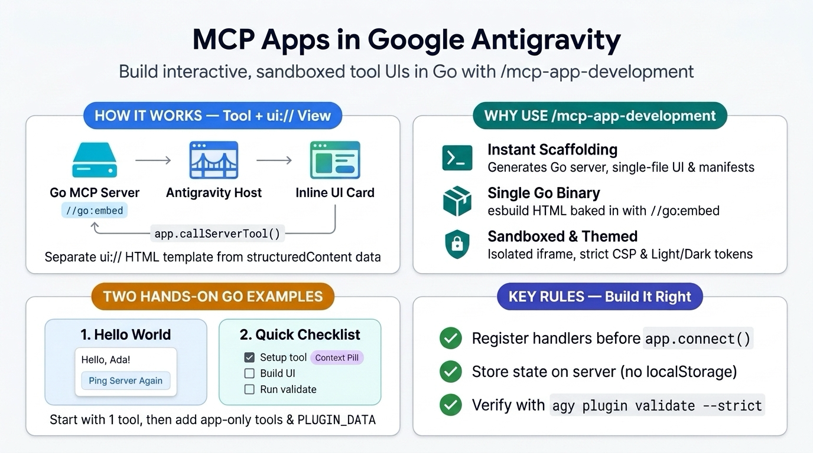

# Building MCP Apps with `/mcp-app-development` in Google Antigravity



Hands-on guides and runnable MCP App plugins for the [MCP Apps specification (SEP-1865)](https://github.com/modelcontextprotocol/ext-apps/blob/main/specification/2026-01-26/apps.mdx) and Google Antigravity.

- **Post 1 (Inline Go MCP Apps):** **[`BLOG_POST.md`](./BLOG_POST.md)** — Introduces MCP Apps basics and scaffolds two inline Go examples with `/mcp-app-development`.
- **Post 2 (Side Panel & Full-Page Views):** **[`BLOG_POST_2.md`](./BLOG_POST_2.md)** — Builds a Local HTTP Request Workbench in Go across `aux_pane` and `global` views with capability gating.
- **Post 3 (Custom File Viewers & Companion Skills):** **[`BLOG_POST_3.md`](./BLOG_POST_3.md)** — Builds a `.jsonl` Log Explorer file viewer (`antigravity-file://`) and pairs it with a companion `SKILL.md`.
- **Extended multi-surface reference:** **[`TUTORIAL.md`](./TUTORIAL.md)** — Additional Python and TypeScript examples under [`examples/`](./examples/).

## Prerequisites

- **Google Antigravity App** (`v2.34.0+`) and the `agy` CLI
- **Go** (`1.25+`) for the Go examples in [`go-examples/`](./go-examples/)
- **Node.js** (`20+`) — used at build time to bundle the single-file UI into `dist/app.html` (not required at runtime for the compiled Go binaries), and for the Node/TypeScript examples
- **Python** (`3.11+`) — only needed for [`examples/01-json-regex-visualizer/`](./examples/01-json-regex-visualizer/)

## Quickstart: Go Examples (`BLOG_POST.md`)

Both Go plugins use the official [`github.com/modelcontextprotocol/go-sdk`](https://github.com/modelcontextprotocol/go-sdk), embed their bundled HTML UI with `//go:embed`, include Go tests, and pass `agy plugin validate --strict`:

| # | Plugin | Stack | Surface | What It Demonstrates |
| :-: | :--- | :--- | :--- | :--- |
| **1** | [`go-examples/01-hello-world`](./go-examples/01-hello-world/) | Go (`go-sdk`) + `//go:embed` + Vanilla JS | **Inline in chat** | Single `say_hello` tool linked to a `ui://` view, text + structured output, host Light/Dark theming, and a live server callback button (`app.callServerTool()`) |
| **2** | [`go-examples/02-quick-checklist`](./go-examples/02-quick-checklist/) | Go (`go-sdk`) + `//go:embed` + Vanilla JS | **Inline in chat** | UI-only tools (`visibility: ["app"]`), server-side persistence in `PLUGIN_DATA`, and attaching remaining items to your next prompt (`app.updateModelContext()`) |

### Build, Test & Install Locally

```bash
git clone https://github.com/rominirani/antigravity-mcp-apps-guide.git
cd antigravity-mcp-apps-guide

# Example 1: Hello World
cd go-examples/01-hello-world
npm --prefix ui install && npm --prefix ui run build   # build-time only: creates dist/app.html
go test -v ./...
mkdir -p scripts && go build -o scripts/hello-server .
agy plugin validate --strict .
agy plugin install .

# Example 2: Quick Checklist
cd ../02-quick-checklist
npm --prefix ui install && npm --prefix ui run build   # build-time only: creates dist/app.html
go test -v ./...
mkdir -p scripts && go build -o scripts/checklist-server .
agy plugin validate --strict .
agy plugin install .
```

## Extended Python & TypeScript Examples (`TUTORIAL.md`)

Every plugin in [`examples/`](./examples/) includes its own `README.md`, verification script, and passes `agy plugin validate --strict`:

| # | Plugin | Stack | Antigravity Surfaces | What It Demonstrates |
| :-: | :--- | :--- | :--- | :--- |
| **0** | [`examples/00-hello-world`](./examples/00-hello-world/) | Node.js ESM + Vanilla JS + `esbuild` | **Inline in chat** | Minimal Node.js starter (`say_hello`) |
| **1** | [`examples/01-json-regex-visualizer`](./examples/01-json-regex-visualizer/) | Python (`mcp` v2) + Vanilla JS + `esbuild` | **Inline in chat** | Shared `ui://` resource across tools, JSON tree & regex highlighting, live app-only Python regex re-evaluation |
| **2** | [`examples/02-sqlite-csv-explorer`](./examples/02-sqlite-csv-explorer/) | TypeScript + React 19 + Vite + `sql.js` | **Side Panel (`aux_pane`)** + **Full Page (`global`)** | Read-only SQLite/CSV explorer, paginated app-only queries, `updateModelContext`, `sendMessage`, capability gating |
| **3** | [`examples/03-repo-architecture-reviewer`](./examples/03-repo-architecture-reviewer/) | TypeScript + React 19 + Vite + Skill | **Side Panel (`aux_pane`)** + **Full Page (`global`)** + **Custom File Viewer (`file`)** | Dependency graph, opening workspace files, background chats, `.archmap` custom file viewer, companion `/repo-review` skill |

## Repository Structure

```text
antigravity-mcp-apps-guide/
├── BLOG_POST.md                          # Post 1: Inline Go MCP Apps + /mcp-app-development
├── BLOG_POST_2.md                        # Post 2: Side Panel & Full-Page Views (HTTP Workbench)
├── BLOG_POST_3.md                        # Post 3: Custom File Viewers & Skills (.jsonl Log Explorer)
├── TUTORIAL.md                           # Extended multi-surface guide (Python & TypeScript)
├── README.md                             # Quickstart & repository map
├── images/                               # Hero infographics, PNG diagrams, and SVG sources
├── go-examples/
│   ├── 01-hello-world/                   # Go + //go:embed Hello World inline plugin
│   └── 02-quick-checklist/               # Go + //go:embed Quick Checklist inline plugin
└── examples/
    ├── 00-hello-world/                   # Node.js ESM Hello World inline plugin
    ├── 01-json-regex-visualizer/         # Python + Vanilla JS inline plugin
    ├── 02-sqlite-csv-explorer/           # TypeScript + React Side Panel & Full Page plugin
    └── 03-repo-architecture-reviewer/    # TypeScript + React + Custom File Viewer + Skill
```

## Official Documentation

- [MCP Apps Overview (`modelcontextprotocol.io`)](https://modelcontextprotocol.io/extensions/apps/overview)
- [MCP Apps Specification — SEP-1865 (`modelcontextprotocol/ext-apps`)](https://github.com/modelcontextprotocol/ext-apps/blob/main/specification/2026-01-26/apps.mdx)
- [Google Antigravity — MCP Apps](https://antigravity.google/docs/mcp-apps)
- [Google Antigravity — `/mcp-app-development`](https://antigravity.google/docs/commands/mcp-app-development)
- [Google Antigravity — Build Plugins](https://antigravity.google/docs/build-plugins)
