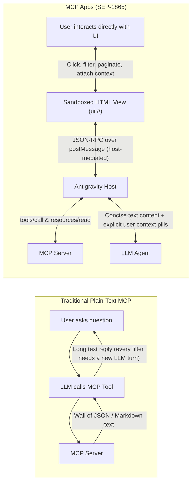
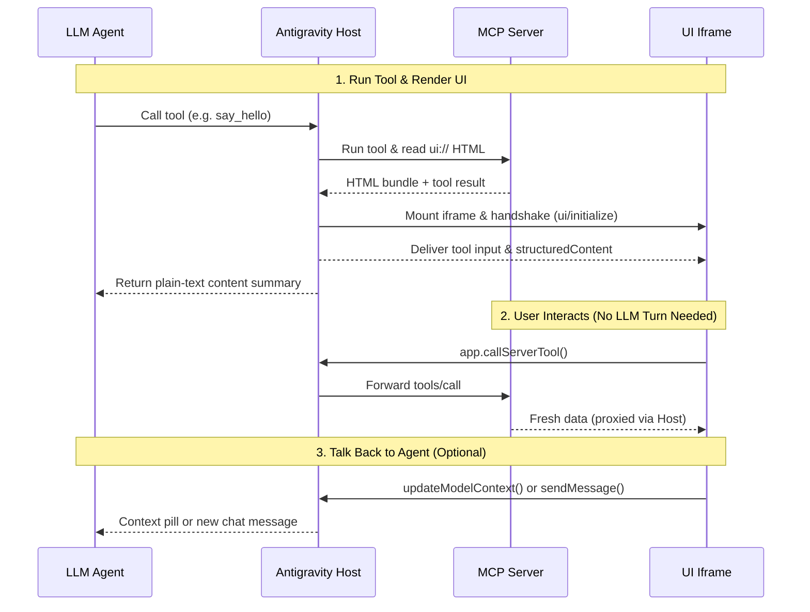
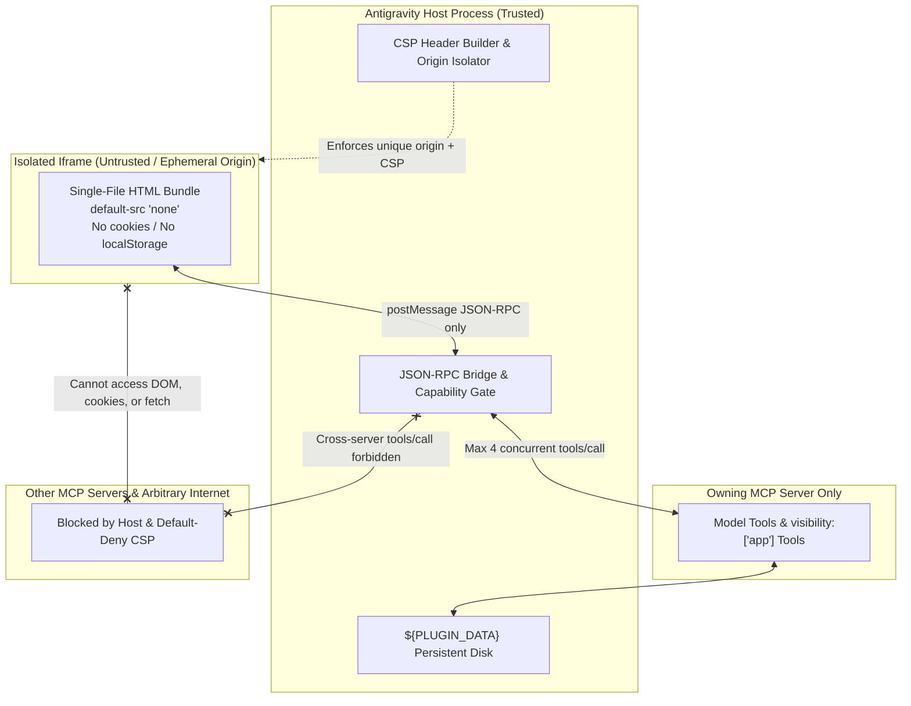
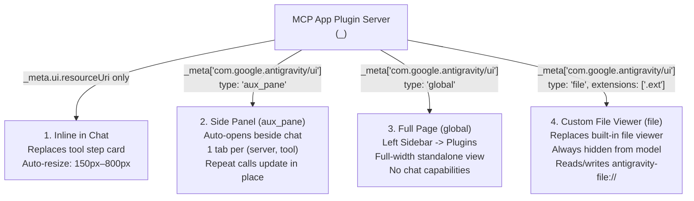
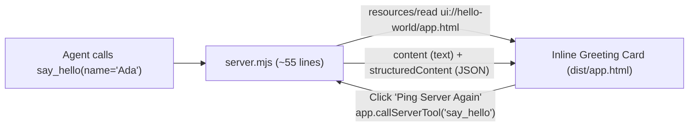
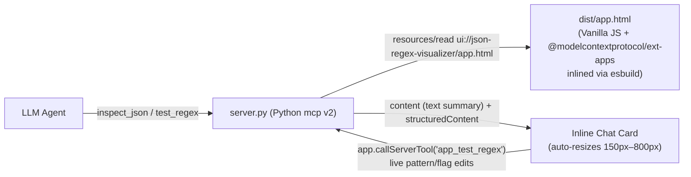
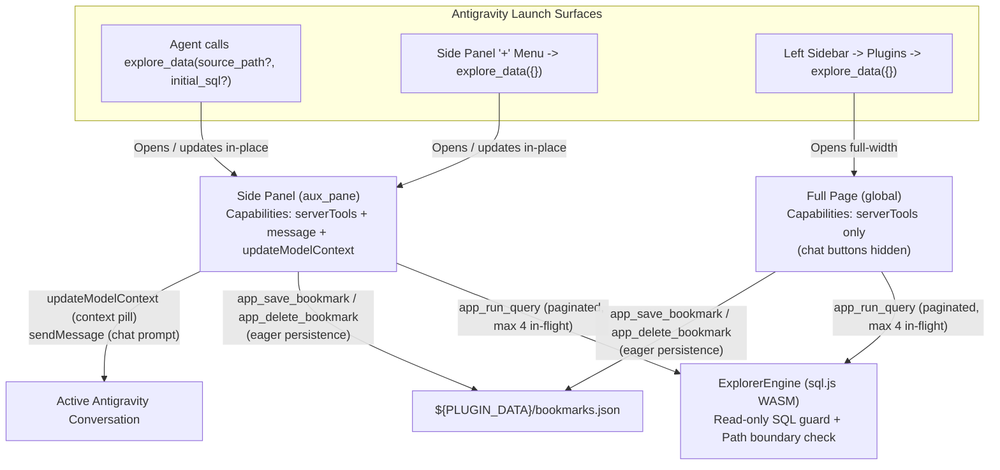
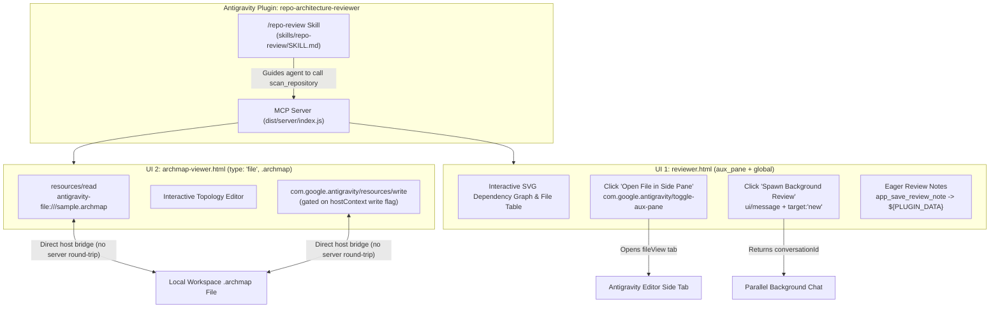

<!--
Suggested Titles (for Blog / Medium / Dev.to):
1. Building MCP Apps with /mcp-app-development in Google Antigravity
2. A Step-by-Step Guide to MCP Apps (SEP-1865) in Google Antigravity
3. Adding Interactive UIs to MCP Tools in Antigravity (Python & TypeScript Examples)
4. Getting Started with /mcp-app-development: Inline Cards, Side Panels, Global Views, and Custom File Viewers
-->

# Building MCP Apps with `/mcp-app-development` in Google Antigravity

> **No prior MCP Apps experience required.** This guide starts from the basics—why the Model Context Protocol (MCP) added a UI extension (SEP-1865), how the protocol and iframe sandbox work, how Google Antigravity extends the spec across four UI surfaces, and how to build, verify, debug, and package **a minimal Hello World app followed by three developer tools** in Python and TypeScript.

---

## What We Will Cover

1. **[The Problem with Plain-Text MCP Tools](#1-the-problem-with-plain-text-mcp-tools)** — Where text-only tool output falls short, and when to choose **MCP Apps** vs. standard MCP tools vs. `/generative_ui`.
2. **[MCP Apps 101: The Official Protocol & Spec (SEP-1865)](#2-mcp-apps-101-the-official-protocol--spec-sep-1865)** — `ui://` resources, `text/html;profile=mcp-app`, `_meta.ui`, `content` vs. `structuredContent`, JSON-RPC over `postMessage`, and the iframe CSP trust boundary.
3. **[What You Can Do in Google Antigravity (`com.google.antigravity/*`)](#3-what-you-can-do-in-google-antigravity)** — Using `/mcp-app-development`, Antigravity's four UI surfaces (`inline`, `aux_pane`, `global`, `file`), host extensions (`toggle-aux-pane`, background chats, `antigravity-file://` read/write), theming tokens, and host limits.
4. **[Example 0 (Hello World): Your First MCP App (Plain JS)](#4-example-0-hello-world-your-first-mcp-app)** — Zero frameworks and no TypeScript build step: **1 tool + 1 `ui://` resource** in ~55 lines each, showing the full bidirectional loop on one screen.
5. **[Example 1: Inline JSON & Regex Visualizer (Python MCP SDK v2 + Vanilla JS)](#5-example-1-inline-json--regex-visualizer-python--vanilla-js)** — Single-file `esbuild` bundling, safe DOM construction without `innerHTML`, shared UI across tools, and live app-only re-evaluation.
6. **[Example 2: Interactive SQLite & CSV Data Explorer (TypeScript + Vite/React)](#6-example-2-interactive-sqlite--csv-data-explorer-typescript--vitereact)** — Side panel (`aux_pane`) + full-page (`global`) entrypoints, empty `{}` defaults, working within the 1 MiB trajectory cap with `visibility: ["app"]` pagination, `updateModelContext` pills, `sendMessage`, capability gating, and `${PLUGIN_DATA}` persistence.
7. **[Example 3: Live Repo Architecture & File Reviewer + `.archmap` Custom File Viewer](#7-example-3-live-repo-architecture--file-reviewer-antigravity-extensions)** — Opening workspace files via `com.google.antigravity/toggle-aux-pane`, starting parallel background review conversations, building a custom `.archmap` file editor (`type: "file"`), and bundling a companion Agent Skill.
8. **[Packaging, Reloading & Validating as an Antigravity Plugin](#8-packaging-reloading--validating-as-an-antigravity-plugin)** — `plugin.json`, `mcp_config.json`, `${PLUGIN_ROOT}`/`${PLUGIN_DATA}`, `RefreshMcpServers`, and `agy plugin validate --strict`.
9. **[Debugging Checklist](#9-debugging-checklist)** — Common symptoms, root causes, and fixes (including strict TypeScript quirks in `@modelcontextprotocol/ext-apps` v2).
10. **[Things to Try Next](#10-things-to-try-next)** — Hands-on exercises and copy-paste `/mcp-app-development` prompts to explore on your own.

---

## 1. The Problem with Plain-Text MCP Tools

If you have used the [Model Context Protocol (MCP)](https://modelcontextprotocol.io), you are already familiar with how it connects AI agents to databases, APIs, and local utilities. An MCP server exposes **tools** (functions the LLM can call) and **resources** (data the client can read).

Text-only tools run into friction once a workflow requires **exploration, visual inspection, or direct human steering**:

- **Large blocks of JSON or Markdown tables**: Asking an agent to inspect a 400-line JSON payload or run exploratory SQL queries clutters the conversation and spends context tokens on raw data that only the *human* needed to scan.
- **Repeated micro-interactions**: Tweaking a regex flag, paging to rows 26–50 of a SQL query, or filtering 80 repository files shouldn't require five back-and-forth LLM turns.
- **No direct manipulation**: Clicking a module in a dependency graph to open its source file, or selecting three anomalous rows to attach to your next prompt, is quick in a UI and tedious in plain text.

### MCP Tools vs. MCP Apps vs. `/generative_ui`

Before writing a line of code, it helps to know which Antigravity tool fits which problem:

| Capability | Plain MCP Tool | **MCP App (`/mcp-app-development`)** | Generative UI (`/generative_ui`) |
| :--- | :--- | :--- | :--- |
| **Backed by live MCP server?** | Yes | **Yes** (same server handles tools & state) | No (one-off HTML generated by the LLM) |
| **Reusable across sessions?** | Yes | **Yes** (installable as a versioned Plugin) | Single conversation artifact |
| **Interactive UI surfaces** | None (text/JSON) | **Inline chat, Side panel, Full page, File viewer** | Inline / artifact widget |
| **Bidirectional server calls** | Model calls only | **UI calls server tools directly (`tools/call`)** | None |
| **CLI / non-UI fallback** | Native text | **Graceful degradation to `content` text** | N/A |

**Rule of thumb:** Use **MCP Apps** whenever you want a *reusable, deterministic, server-backed UI* (dashboards, query workbenches, visualizers, custom file editors) that ships inside an Antigravity plugin. Use `/generative_ui` for one-off bespoke diagrams or prototypes created on the fly for a single chat.



---

## 2. MCP Apps 101: The Official Protocol & Spec (SEP-1865)

**MCP Apps** is an official, open extension to MCP defined in **[SEP-1865 (`specification/2026-01-26/apps.mdx`)](https://github.com/modelcontextprotocol/ext-apps/blob/main/specification/2026-01-26/apps.mdx)** and maintained in the [modelcontextprotocol/ext-apps](https://github.com/modelcontextprotocol/ext-apps) repository. It unifies patterns pioneered by MCP-UI and OpenAI's Apps SDK into a single portable standard supported across compliant hosts—including **Google Antigravity App (`v2.34.0+`)**, Claude, ChatGPT, and VS Code.

Every MCP App is built on **five foundational concepts**:

### Concept 1: Capability Negotiation & Progressive Enhancement

MCP Apps is an **optional extension** identified by the string `io.modelcontextprotocol/ui`. During the standard MCP `initialize` handshake, a UI-capable host advertises support in `capabilities.extensions`:

```json
{
  "method": "initialize",
  "params": {
    "protocolVersion": "2024-11-05",
    "capabilities": {
      "extensions": {
        "io.modelcontextprotocol/ui": {
          "mimeTypes": ["text/html;profile=mcp-app"]
        },
        "com.google.antigravity/ui": {
          "entrypoints": ["aux_pane", "global", "file"]
        }
      }
    }
  }
}
```

If a client does **not** advertise `io.modelcontextprotocol/ui`—for example, when your plugin runs inside **Antigravity CLI (`agy`)** or a headless script—the tool still executes normally and the host reads its plain-text `content` array. Nothing breaks.

### Concept 2: The Two-Part Server Contract (Tool + `ui://` Resource)

An MCP App does **not** stuff HTML strings inside tool responses. Instead, SEP-1865 strictly separates **presentation** (a predeclared static HTML template) from **data** (dynamic tool arguments and results):

1. **Declare a UI Resource** using the `ui://` URI scheme and exact MIME type `text/html;profile=mcp-app`:
   ```json
   {
     "uri": "ui://my-server/app.html",
     "name": "My Interactive View",
     "mimeType": "text/html;profile=mcp-app"
   }
   ```
2. **Link a Tool to that Resource** via `_meta.ui.resourceUri`:
   ```json
   {
     "name": "inspect_json",
     "description": "Parse and visualize a JSON payload",
     "inputSchema": { "type": "object", "properties": { "json_text": { "type": "string" } } },
     "_meta": {
       "ui": {
         "resourceUri": "ui://my-server/app.html"
       }
     }
   }
   ```

> **Why predeclare `ui://` resources instead of embedding HTML in tool results?**
> Predeclared resources let hosts inspect CSP policies upfront, prefetch/validate templates, keep conversation trajectories lean (Antigravity **never** stores `ui://` HTML inside the trajectory), and allow multiple tools to share one UI bundle.

### Concept 3: Tool Visibility (`"model"` vs. `"app"`)

Interactive UIs often need backend endpoints that the LLM itself should never call—for example, `app_run_query` (fetching page 3 of a table), `app_save_bookmark`, or `app_test_regex`. SEP-1865 solves this with `_meta.ui.visibility`:

| `_meta.ui.visibility` | Visible to LLM (`tools/list`)? | Callable by UI (`app.callServerTool`)? | Typical Use Case |
| :--- | :---: | :---: | :--- |
| Omitted or `["model", "app"]` | Yes | Yes | Primary tool the agent calls and the UI can refresh |
| `["model"]` | Yes | **No** | Entrypoint tool only the agent should trigger |
| `["app"]` | **No** | Yes | Private UI helpers: pagination, live filtering, eager state saves |

> **Antigravity CLI caveat:** Because non-UI hosts like `agy` do not mount iframes, Antigravity CLI ignores `_meta.ui.visibility` and exposes all listed tools to the model. Always write clear tool descriptions and enforce server-side validation on app-only tools too!

### Concept 4: Dual-Payload Tool Results (`content` vs. `structuredContent`)

When an MCP App tool finishes executing, return **both**:

- **`content`**: A concise, human- and LLM-readable plain-text summary. The model reads this, and non-UI hosts (like `agy`) rely on it exclusively.
- **`structuredContent`**: Typed JSON optimized for your UI iframe (`ontoolresult`).

```json
{
  "content": [
    { "type": "text", "text": "JSON Inspection: Checkout Health\n- Root type: dict | 8 keys | max depth 3" }
  ],
  "structuredContent": {
    "mode": "json",
    "title": "Checkout Health",
    "stats": { "totalKeys": 8, "maxDepth": 3 },
    "data": { "service": "checkout-api", "healthy": true }
  }
}
```

> **Security tip:** Never put secrets or hidden answers in `content` (the LLM sees it), and remember that in Antigravity, the persisted `CallToolResult` on a trajectory step is capped at **1 MiB**. Return summaries initially and fetch larger payloads via an `app`-only tool.

### Concept 5: Bidirectional JSON-RPC over `postMessage`

Inside the sandboxed iframe, your HTML document talks to the host using **JSON-RPC 2.0 over `window.parent.postMessage`**. **Never hand-write this bridge.** Always use the official `@modelcontextprotocol/ext-apps` SDK (`App` class for Vanilla JS, or `useApp` + `useHostStyles` from `@modelcontextprotocol/ext-apps/react`):

- Handles the `ui/initialize` → `ui/notifications/initialized` handshake automatically
- Negotiates protocol version and responds to `ping`
- Runs a `ResizeObserver` to send debounced `ui/notifications/size-changed` notifications (auto-resize)
- Validates all payloads with Standard Schema / Zod v4

Here is the lifecycle in three simple stages—rendering the UI, handling user clicks directly on the server, and optionally talking back to the agent:



> **Important ordering rule:** Always register `app.ontoolinput`, `app.ontoolresult`, `app.ontoolcancelled`, and `app.onhostcontextchanged` **before** calling `await app.connect()`. Because the host sends `tool-input` and `tool-result` right after `ui/notifications/initialized`, registering handlers *after* `connect()` causes a race condition where your UI misses the initial data and stays empty. (In React, `useApp({ onAppCreated })` handles this ordering for you.)

### The Security & Trust Boundary Model

Why is it safe for an AI host to execute HTML returned by a third-party MCP server? Because SEP-1865 and Antigravity enforce **defense in depth**:



Key security consequences for your code:

1. **Bundle everything into a single HTML file.** Antigravity's default CSP is `default-src 'none'` (inline `<script>` and `<style>` plus `data:`/`blob:` media are permitted, while external `<script src>`, `fetch`, WebSockets, forms, and nested frames are blocked). Use **Vite + `vite-plugin-singlefile`** or **`esbuild --bundle`** to inline all JS and CSS.
2. **Do not rely on `localStorage`, `IndexedDB`, or cookies.** Every view mounts on a fresh unique (or opaque) origin; browser storage is unavailable or discarded when the view closes and is never shared across views. Persist state server-side in `${PLUGIN_DATA}` through app-only tools.
3. **Prefer `tools/call` over `connectDomains`.** If your UI needs external data, fetch it in your MCP server via a `visibility: ["app"]` tool instead of opening `_meta.ui.csp.connectDomains`. Your server already holds credentials safely (Backend-for-Frontend pattern) and every call remains auditable.
4. **Only bare origins are accepted in `_meta.ui.csp`.** Entries in `resourceDomains`, `connectDomains`, `frameDomains`, or `baseUriDomains` must be bare `http(s)`/`ws(s)` origins (optionally with `*.` subdomain or port, e.g., `https://cdn.example.com`). Paths, keywords, or quotes are silently dropped.

---

## 3. What You Can Do in Google Antigravity

### What is `/mcp-app-development`?

In the **Antigravity App**, `/mcp-app-development` is a built-in **slash command** backed by the `mcp-app-development` Agent Skill. Prefixing a prompt with `/mcp-app-development` loads Antigravity's MCP Apps reference directly into the agent's context on the first turn—including:

- Exact `ui://` resource and `text/html;profile=mcp-app` rules
- Antigravity's `com.google.antigravity/ui` entrypoints (`aux_pane`, `global`, `file`)
- Native host RPCs (`com.google.antigravity/toggle-aux-pane`, background `target: "new"` messages)
- Host CSS variables and theming rules
- Plugin packaging (`plugin.json`, `mcp_config.json`, `${PLUGIN_ROOT}`, `${PLUGIN_DATA}`) and `RefreshMcpServers` reload commands
- The official debugging checklist

**Example prompts you can run directly in Antigravity:**

```text
/mcp-app-development Scaffold a Python + Vanilla JS inline MCP App that visualizes JSON payloads and tests Python regular expressions, bundled as a single HTML file with esbuild.
```

```text
/mcp-app-development Add a side panel (aux_pane) and full-page (global) entrypoint to my MCP server, hide chat-only buttons in global view, and persist saved queries in ${PLUGIN_DATA}.
```

```text
/mcp-app-development Debug why my inline MCP App renders a blank frame—inspect my MIME type, CSP resourceDomains, and whether ontoolresult is registered before app.connect().
```

### Antigravity's Four UI Surfaces

Where standard SEP-1865 focuses primarily on inline chat cards, Antigravity advertises `com.google.antigravity/ui` (`{"entrypoints": ["aux_pane", "global", "file"]}`) to support **four surfaces**:



Let's compare all four surfaces plus Antigravity CLI side by side:

| Surface | Declared Via `_meta` | Launch Arguments | Key Host Behaviors |
| :--- | :--- | :--- | :--- |
| **Inline in chat** | `ui.resourceUri` only (no `aux_pane`/`global`/`file`) | Agent's tool arguments | Replaces the collapsed MCP step card in chat. Auto-resizes up to **800 px** (**150 px** fallback if no `size-changed` arrives within **100 ms**). |
| **Side panel (`aux_pane`)** | `ui.resourceUri` + `com.google.antigravity/ui.entrypoints: [{ type: "aux_pane", title }]` | Agent args (auto-open) or **`{}`** (manual launch from `+` menu / Overview > Plugins) | Does **not** render inline. One persistent tab per `(server, tool)`. Repeat agent calls to the same tool update the open pane in place. |
| **Full page (`global`)** | `ui.resourceUri` + `entrypoints: [{ type: "global", title }]` | **`{}`** (launched from **Plugins** in left sidebar) | Full-width standalone workspace view with **no owning conversation**. `message` and `updateModelContext` capabilities are omitted—gate those buttons. |
| **Custom file viewer (`file`)** | `ui.resourceUri` + `entrypoints: [{ type: "file", title, extensions: [".ext"] }]` | `{"file": {"name", "resourceUri": "antigravity-file://<uuid>/..."}}` | Put on its own separate tool. **Unconditionally hidden from the model** regardless of `visibility`. Uses plugin `logo` as tab icon. First enabled server claiming an extension wins. |
| **Antigravity CLI (`agy`)** | Standard `mcp_config.json` | Agent's tool arguments | No iframes. Connects to `<plugin>_<server>`, ignores `_meta.ui.visibility`, and feeds plain-text `content` directly to the model. |

### Antigravity-Specific Host Actions & Extensions

Beyond standard SDK methods (`app.callServerTool`, `app.sendMessage`, `app.updateModelContext`, `app.openLink`), Antigravity adds three host extensions:

1. **Open any workspace file in Antigravity's side panel (`com.google.antigravity/toggle-aux-pane`)**
   Not advertised in `hostCapabilities` (because `@modelcontextprotocol/ext-apps` strips unknown capability keys), so call it via `app.request()` and catch JSON-RPC `-32601` for non-Antigravity hosts:
   ```ts
   const res = await app.request(
     {
       method: "com.google.antigravity/toggle-aux-pane",
       params: { tabType: "fileView", uri: "file:///abs/path/to/file.ts" },
     },
     z.object({ isError: z.boolean().optional() }).passthrough()
   );
   ```
   Returns `{ isError: true }` on surfaces without a side panel (such as `global` view) or for invalid `file://` URIs.

2. **Start an isolated background conversation (`com.google.antigravity/message`)**
   Attach `_meta: { "com.google.antigravity/message": { "target": "new" } }` to a `ui/message` request. Instead of posting into the active thread, Antigravity launches a new background conversation in the same project and returns its ID inside `_meta["com.google.antigravity/message"].conversationId`.

3. **Custom File Viewer Read & Write (`antigravity-file://`)**
   - **Read**: Call `app.readServerResource({ uri: file.resourceUri })` (`resources/read`). Antigravity intercepts `antigravity-file://` URIs directly without calling your MCP server and returns a base64 `blob` (`application/octet-stream`, max **10 MiB**)—so raw host filesystem paths are never exposed to the iframe.
   - **Write (local files only)**: Check `hostContext["com.google.antigravity/resources"]?.write`. When true, send `com.google.antigravity/resources/write` with `{ uri, text }` (UTF-8) or `{ uri, blob }` (base64), up to **10 MiB**.

### Antigravity Host Limits

| Host Limit | Value | Design Impact |
| :--- | :--- | :--- |
| **HTML & `antigravity-file://` size** | **10 MiB** | Keep single-file bundles lean (typically 300–700 KiB); avoid embedding large media directly in HTML. |
| **Persisted `CallToolResult`** | **1 MiB** | Trajectory steps drop results > 1 MiB (the app only gets `ontoolinput`). Return a summary + page 1 initially, then fetch additional pages via `visibility: ["app"]` tools. |
| **Concurrent `tools/call`** | **4 per view** | Scoped strictly to the view's own server. In-flight calls abort on close/reload. Guard rapid UI clicks with a client-side concurrency counter. |
| **Hidden background frames** | **5 (LRU)** | Switching tabs keeps hidden `aux_pane`/`global` frames alive up to 5 frames before evicting the least-recently-used frame. |
| **Inline card height** | **150 px** fallback / **800 px** max | Fallback triggers if no `size-changed` arrives within 100 ms. Taller views scroll internally; side pane & global views ignore reported size and fill 100%. |
| **Teardown notification** | **Not sent** | Antigravity does **not** send `ui/resource-teardown`. Persist user edits eagerly via an app-only tool. |

### Host Theming & CSS Custom Properties

Antigravity passes `theme` (`"light"` | `"dark"`) and standard SEP-1865 CSS tokens in `hostContext.styles.variables`:

- `--color-background-{primary,secondary,tertiary,inverse,disabled,info,danger,success,warning}`
- `--color-text-{primary,secondary,tertiary,inverse,info,danger,success,warning,disabled}`
- `--color-border-{primary,secondary,inverse,info,danger,success,warning}`
- `--color-ring-{primary,info,danger,success,warning}`
- `--font-sans`

Apply them right after `connect()` **and** in `onhostcontextchanged` (or call `useHostStyles(app, hostContext)` in React), and **always specify CSS fallback values** because omitted tokens won't be defined:

```css
body {
  background: var(--color-background-primary, #ffffff);
  color: var(--color-text-primary, #1f2328);
  font-family: var(--font-sans, system-ui, -apple-system, sans-serif);
}
```

---

## 4. Example 0 (Hello World): Your First MCP App

> **Companion Code:** [`examples/00-hello-world/`](./examples/00-hello-world/)
> **Stack:** Plain JavaScript (Node ESM `server.mjs` + Vanilla JS `ui/app.js` + `esbuild`). No React, Vite, TypeScript compiler, or Python virtualenv.
> **Surface:** Inline in chat (`_meta.ui.resourceUri`).

Before moving to multi-tool developer utilities, let's start with a **minimal MCP App**: **1 tool (`say_hello`)** and **1 UI resource (`ui://hello-world/app.html`)**.

When the agent calls `say_hello(name="Ada")`, Antigravity renders a themed greeting card inline in the conversation showing the server timestamp and call counter. Clicking **Ping Server Again** inside the card calls `say_hello` directly on the server via `app.callServerTool()`—without another LLM turn.



### Generate It with `/mcp-app-development`

If you want Antigravity to scaffold this starter from an empty folder, run:

```text
/mcp-app-development Create a minimal Hello World MCP App plugin in plain Node.js ESM and Vanilla JS (no React/TypeScript): one tool `say_hello(name?)` linked to `ui://hello-world/app.html` bundled with esbuild, themed with host CSS variables, and a "Ping Server Again" button that calls `say_hello` via `app.callServerTool()`.
```

### Step 1: The MCP Server (`server.mjs`)

Here is the full server in [`examples/00-hello-world/server.mjs`](./examples/00-hello-world/server.mjs):

```js
import {
  registerAppResource,
  registerAppTool,
  RESOURCE_MIME_TYPE,
} from "@modelcontextprotocol/ext-apps/server";
import { McpServer } from "@modelcontextprotocol/server";
import { StdioServerTransport } from "@modelcontextprotocol/server/stdio";
import fs from "node:fs/promises";
import path from "node:path";
import { fileURLToPath } from "node:url";
import { z } from "zod";

const APP_URI = "ui://hello-world/app.html";
const __dirname = path.dirname(fileURLToPath(import.meta.url));
const HTML_PATH = path.join(__dirname, "dist", "app.html");

const server = new McpServer({ name: "hello-mcp-app", version: "1.0.0" });
let pingCount = 0;

// 1. Register the single-file HTML document as a `ui://` resource.
registerAppResource(
  server,
  "Hello World Card",
  APP_URI,
  {
    description: "Minimal inline greeting and server clock MCP App.",
    mimeType: RESOURCE_MIME_TYPE,
    _meta: { ui: { prefersBorder: true } },
  },
  async () => ({
    contents: [
      {
        uri: APP_URI,
        mimeType: RESOURCE_MIME_TYPE,
        text: await fs.readFile(HTML_PATH, "utf-8"),
        _meta: { ui: { prefersBorder: true } },
      },
    ],
  })
);

// 2. Register ONE tool and point `_meta.ui.resourceUri` at the resource above.
registerAppTool(
  server,
  "say_hello",
  {
    title: "Say Hello",
    description: "Greet someone by name and display an interactive inline greeting card.",
    inputSchema: z.object({
      name: z.string().max(80).optional().default("Developer"),
    }),
    _meta: { ui: { resourceUri: APP_URI } },
  },
  async ({ name }) => {
    pingCount += 1;
    const cleanName = name.trim() || "Developer";
    const serverTime = new Date().toISOString();
    const greeting = `Hello, ${cleanName}!`;

    return {
      // Plain-text fallback for the LLM and CLI hosts (like `agy`)
      content: [
        { type: "text", text: `${greeting} (Server time: ${serverTime}, call #${pingCount})` },
      ],
      // Structured JSON delivered directly to the iframe's `ontoolresult`
      structuredContent: { name: cleanName, greeting, serverTime, pingCount },
    };
  }
);

await server.connect(new StdioServerTransport());
```

Only two registrations are needed (`registerAppResource` and `registerAppTool`), linked by the `ui://hello-world/app.html` URI.

### Step 2: The UI Script (`ui/app.js`)

Here is the full frontend in [`examples/00-hello-world/ui/app.js`](./examples/00-hello-world/ui/app.js). It shows three key patterns in one place:

1. Register `ontoolinput`, `ontoolresult`, and `onhostcontextchanged` **before** `await app.connect()`.
2. Apply host theming both on `connect()` and on live `onhostcontextchanged`.
3. Use `textContent` (not `innerHTML`) and gate `refreshBtn` on `app.getHostCapabilities()?.serverTools`.

```js
import {
  App,
  applyDocumentTheme,
  applyHostStyleVariables,
} from "@modelcontextprotocol/ext-apps";

const greetingEl = document.getElementById("greeting");
const metaEl = document.getElementById("meta");
const refreshBtn = document.getElementById("refresh-btn");

let currentName = "Developer";
const app = new App({ name: "Hello MCP App", version: "1.0.0" }, {});

function applyTheme(ctx) {
  if (!ctx) return;
  if (ctx.theme) applyDocumentTheme(ctx.theme);
  if (ctx.styles?.variables) applyHostStyleVariables(ctx.styles.variables);
}

function render(data) {
  if (!data) return;
  currentName = data.name || currentName;
  greetingEl.textContent = data.greeting || `Hello, ${currentName}!`;
  metaEl.textContent = `Server time: ${data.serverTime} · Server call #${data.pingCount}`;
}

// 1. Register ALL handlers BEFORE calling app.connect().
app.ontoolinput = ({ arguments: args }) => {
  if (args?.name) currentName = String(args.name);
  greetingEl.textContent = `Saying hello to ${currentName}...`;
};
app.ontoolresult = (result) => render(result?.structuredContent);
app.onhostcontextchanged = applyTheme;

// 2. Interactive UI -> Server callback (no LLM round trip!).
refreshBtn.addEventListener("click", async () => {
  refreshBtn.disabled = true;
  try {
    const result = await app.callServerTool({
      name: "say_hello",
      arguments: { name: currentName },
    });
    render(result?.structuredContent);
  } finally {
    refreshBtn.disabled = false;
  }
});

// 3. Complete handshake, sync initial theme, and gate capabilities.
await app.connect();
applyTheme(app.getHostContext());
if (!app.getHostCapabilities()?.serverTools) {
  refreshBtn.hidden = true;
}
```

[`ui/build.mjs`](./examples/00-hello-world/ui/build.mjs) bundles `ui/app.js` (along with `@modelcontextprotocol/ext-apps`) using `esbuild` and inlines it into a single `dist/app.html` document so it satisfies Antigravity's default-deny CSP (`default-src 'none'`) out of the box.

### Step 3: Build, Verify & Validate

```bash
cd examples/00-hello-world
npm install
npm run build
npm run verify
agy plugin validate --strict .
```

**Verification Output:**

```text
Built .../examples/00-hello-world/dist/app.html (651.4 KiB)

=== TOOLS ===
- say_hello: _meta={"ui":{"resourceUri":"ui://hello-world/app.html"},"ui/resourceUri":"ui://hello-world/app.html"}
=== RESOURCE ===
mimeType=text/html;profile=mcp-app | size=667,033 bytes

=== Call #1 (from agent) ===
Hello, Ada! (Server time: 2026-11-25T02:24:14.489Z, call #1)
=== Call #2 (simulating 'Ping Server Again' button click) ===
Hello, Ada! (Server time: 2026-11-25T02:24:14.490Z, call #2)

ALL EXAMPLE 0 CHECKS PASSED!
=== AGY PLUGIN VALIDATE ===
Validating hello-mcp-app (plugin.json)

  skills 0 · agents 0 · rules 0 · hooks 0 · mcpServers 1 · sidecars 0

✔ Validation passed
```

Every MCP App follows this same structure. The next three examples build on it with additional server patterns, UI surfaces, and Antigravity extensions.

---

## 5. Example 1: Inline JSON & Regex Visualizer (Python + Vanilla JS)

> **Companion Code:** [`examples/01-json-regex-visualizer/`](./examples/01-json-regex-visualizer/)
> **Stack:** Python MCP SDK v2 (`mcp>=2.0.0`, `MCPServer`) + Vanilla JavaScript (no framework) + `esbuild` single-file HTML bundler.
> **Surface:** Inline in chat (`_meta.ui.resourceUri`).

### What This Example Covers

Using Python on the server and Vanilla JS on the client, Example 1 builds on Hello World with **one shared `ui://` HTML resource, two model tools, and one app-only helper**.



### Step 1: The Python MCP Server (`server.py`)

In **Python MCP SDK v2 (`mcp>=2.0.0`)**, the server class is `MCPServer` from `mcp.server` (in v1 it was `FastMCP` from `mcp.server.fastmcp`), and both `@mcp.tool(..., meta=...)` and `@mcp.resource(..., mime_type=..., meta=...)` accept MCP Apps metadata directly.

Here is the core setup in [`examples/01-json-regex-visualizer/server.py`](./examples/01-json-regex-visualizer/server.py):

```python
from mcp import types
from mcp.server import MCPServer

APP_URI = "ui://json-regex-visualizer/app.html"
MIME_TYPE = "text/html;profile=mcp-app"

mcp = MCPServer("json-regex-visualizer")

INLINE_UI_META = {"ui": {"resourceUri": APP_URI}}
APP_ONLY_META = {"ui": {"visibility": ["app"]}}

@mcp.resource(
    APP_URI,
    name="JSON & Regex Visualizer UI",
    mime_type=MIME_TYPE,
    meta={"ui": {"prefersBorder": True}},
)
def visualizer_app_html() -> str:
    # Fast UI hot-reload: point JSON_REGEX_APP_HTML at a local file to skip restarts
    override = os.environ.get("JSON_REGEX_APP_HTML")
    if override:
        candidate = Path(override).resolve()
        if candidate.is_file() and candidate.suffix.lower() == ".html":
            return candidate.read_text(encoding="utf-8")
    return DEFAULT_HTML_PATH.read_text(encoding="utf-8")
```

Four design choices in `server.py`:

1. **One `ui://` resource backs two tools** (`inspect_json` and `test_regex`). Each tool returns a `mode` field (`"json"` or `"regex"`) inside `structured_content` (serialized on the wire as `structuredContent`).
2. **Concise `content` + detailed `structured_content`**: For `inspect_json`, the LLM receives a compact 4-line summary (root type, byte size, max depth, key counts, top-level keys) instead of spending context tokens on raw JSON, while the inline card renders the searchable tree.
3. **Python-accurate live editing via `visibility: ["app"]`**: JavaScript regex engines differ subtly from Python's `re` (e.g. `(?P<name>...)` named groups, `re.VERBOSE`). By exposing `app_test_regex` with `meta={"ui": {"visibility": ["app"]}}`, the user can edit patterns and toggle `i`/`m`/`s`/`x` flags inside the inline card and evaluate them against Python's `re` module without adding another tool to the LLM's tool list.
4. **Input bounds**: Inputs are capped (`MAX_JSON_BYTES = 100_000`, `MAX_REGEX_TEXT_BYTES = 50_000`, `MAX_PATTERN_CHARS = 500`, `MAX_MATCHES = 500`, `MAX_TREE_DEPTH = 32`) to protect against oversized payloads.

### Step 2: Bundling Vanilla JS into One Self-Contained HTML Document (`ui/build.mjs`)

Because Antigravity's default CSP blocks external `<script src>` and `<link href>` tags, [`ui/build.mjs`](./examples/01-json-regex-visualizer/ui/build.mjs) uses `esbuild` to bundle `@modelcontextprotocol/ext-apps` + `src/app.js` into an IIFE and inline both JS and CSS directly into `dist/app.html`:

```js
const jsResult = await esbuild.build({
  entryPoints: [path.join(__dirname, "src", "app.js")],
  bundle: true,
  minify: true,
  format: "iife",
  target: ["es2022"],
  write: false,
});

const safeJs = jsResult.outputFiles[0].text.replace(/<\/script>/gi, "<\\/script>");
const html = template
  .replace("/* __INLINE_CSS__ */", () => safeCss)
  .replace("/* __INLINE_JS__ */", () => safeJs);
```

### Step 3: Safe Vanilla DOM & SDK Wiring (`ui/src/app.js`)

In [`ui/src/app.js`](./examples/01-json-regex-visualizer/ui/src/app.js), two practices stand out:

1. **No `innerHTML` usage.** Because this app renders arbitrary user-supplied JSON and regex text (which might contain `<script>` or `` strings), every DOM node—including highlighted regex `<mark>` spans—is constructed with `document.createElement()`, `textContent`, `document.createTextNode()`, and `replaceChildren()`. This avoids HTML injection when inspecting untrusted input.
2. **Handlers registered before `app.connect()`**, with the host theme synced both on connect and on live theme switches:

```js
import {
  App,
  applyDocumentTheme,
  applyHostStyleVariables,
} from "@modelcontextprotocol/ext-apps";

const app = new App({ name: "JSON & Regex Visualizer", version: "1.0.0" }, {});

function applyHostContext(ctx) {
  if (!ctx) return;
  if (ctx.theme) applyDocumentTheme(ctx.theme);
  if (ctx.styles?.variables) applyHostStyleVariables(ctx.styles.variables);
}

// 1. Register ALL handlers BEFORE connect()
app.ontoolinput = ({ arguments: args }) => showLoading(args);
app.ontoolresult = (result) => {
  currentPayload = result?.structuredContent ?? null;
  render();
};
app.ontoolcancelled = ({ reason }) => showError(`Tool cancelled: ${reason}`);
app.onhostcontextchanged = applyHostContext;

// 2. Connect and apply initial theme
await app.connect();
applyHostContext(app.getHostContext());
```

### Step 4: Build & Verification Output

Run the build, Python stdio MCP test script, and strict plugin validator:

```bash
cd examples/01-json-regex-visualizer
chmod +x scripts/run-server.sh
(cd ui && npm install && npm run build)
python3 -m venv .venv
.venv/bin/pip install "mcp>=2.0.0"
.venv/bin/python test_mcp.py
agy plugin validate --strict .
```

**Verification Output:**

```text
Built single-file MCP App bundle: .../01-json-regex-visualizer/dist/app.html (663.4 KiB)

=== TOOLS ===
- inspect_json: meta={'ui': {'resourceUri': 'ui://json-regex-visualizer/app.html'}}
- test_regex: meta={'ui': {'resourceUri': 'ui://json-regex-visualizer/app.html'}}
- app_test_regex: meta={'ui': {'visibility': ['app']}}

=== RESOURCES ===
- ui://json-regex-visualizer/app.html (text/html;profile=mcp-app) meta={'ui': {'prefersBorder': True}}

=== UI RESOURCE ===
mimeType=text/html;profile=mcp-app | size=679,301 bytes | has_doctype=True

=== inspect_json (plain-text content for LLM/CLI) ===
JSON Inspection: Checkout Health
- Root type: dict | Size: 161 bytes | Max depth: 3
- Nodes: 3 objects (8 keys), 1 arrays, 4 strings, 2 numbers, 1 booleans, 0 nulls
- Top-level keys (4): service, version, healthy, endpoints

=== test_regex (plain-text content for LLM/CLI) ===
Regex Test: Service Log Matcher
- Pattern: /(?P<level>ERROR|WARN)\s+(?P<code_id>[A-Z]+-\d+):\s+(?P<msg>.+)/m
- Matches: 2
  [0] (23..57): 'WARN  DB-408: query exceeded 250ms' | groups=['WARN', 'DB-408', 'query exceeded 250ms']
  [1] (58..95): 'ERROR AUTH-401: expired session token' | groups=['ERROR', 'AUTH-401', 'expired session token']

ALL EXAMPLE 1 CHECKS PASSED!

=== AGY PLUGIN VALIDATE ===
Validating json-regex-visualizer (plugin.json)

  skills 0 · agents 0 · rules 0 · hooks 0 · mcpServers 1 · sidecars 0

✔ Validation passed
```

---

## 6. Example 2: Interactive SQLite & CSV Data Explorer (TypeScript + Vite/React)

> **Companion Code:** [`examples/02-sqlite-csv-explorer/`](./examples/02-sqlite-csv-explorer/)
> **Stack:** TypeScript MCP SDK v2 (`@modelcontextprotocol/server`, `@modelcontextprotocol/ext-apps` v2, `zod` v4, pure-WASM `sql.js`) + React 19 + Vite + `vite-plugin-singlefile`.
> **Surfaces:** Side Panel (`aux_pane`) + Full Page (`global`).

### What This Example Covers

Inline cards work well for compact widgets, while data exploration benefits from more space—a schema sidebar, a SQL editor, a paginated table, and saved query bookmarks. Example 2 moves to a **Side Panel + Full-Page** workbench and addresses five practical requirements:

1. **Launching with `{}`**: When users open your app from the side panel `+` menu or **Plugins** in the left sidebar, Antigravity invokes the tool with empty `{}` arguments. Making every input field optional and loading a built-in sample database (`services`, `deployments`, `incidents`) ensures manual launches work out of the box.
2. **Working within the 1 MiB trajectory result cap**: `explore_data` returns only schema metadata + page 1 (25 rows). Subsequent queries and pages flow through `app_run_query` (`visibility: ["app"]`).
3. **Respecting the 4-concurrent-call limit**: The UI tracks in-flight `callServerTool()` promises with a client-side `MAX_IN_FLIGHT = 4` guard.
4. **Talking back to the agent**: Users can select rows and click **Attach Selected Rows to Prompt** (`app.updateModelContext()`)—which displays a context pill on their next message—or click **Ask Agent to Analyze Query** (`app.sendMessage()`).
5. **Surface-aware capability gating**: In Full-Page (`global`) mode, there is no owning conversation, so Antigravity omits `message` and `updateModelContext` from `hostCapabilities`. The UI inspects `app.getHostCapabilities()` and hides conversation-only buttons accordingly.



### Step 1: Server Registration with `com.google.antigravity/ui` (`src/server/server.ts`)

Using `@modelcontextprotocol/ext-apps/server`, `registerAppTool` registers both standard SEP-1865 metadata (`_meta.ui`) and Antigravity's `com.google.antigravity/ui` entrypoints (and automatically mirrors the legacy `_meta["ui/resourceUri"]` key for compatibility with older hosts):

```ts
import {
  registerAppResource,
  registerAppTool,
  RESOURCE_MIME_TYPE,
} from "@modelcontextprotocol/ext-apps/server";
import { McpServer } from "@modelcontextprotocol/server";
import { z } from "zod";

registerAppTool(
  server,
  "explore_data",
  {
    title: "SQLite & CSV Explorer",
    description:
      "Open the interactive SQLite & CSV Data Explorer in the side panel or full page.",
    inputSchema: z.object({
      source_path: z.string().optional(),
      initial_sql: z.string().optional(),
      title: z.string().optional(),
    }),
    _meta: {
      ui: { resourceUri: APP_URI },
      "com.google.antigravity/ui": {
        entrypoints: [
          { type: "aux_pane", title: "SQLite & CSV Explorer" },
          { type: "global", title: "SQLite & CSV Explorer" },
        ],
      },
    },
  },
  async (args) => { /* load built-in DB or validated CSV/SQLite file */ }
);
```

And notice how `app_run_query` and `app_save_bookmark` declare `_meta: { ui: { visibility: ["app"] } }` so the LLM stays focused on high-level analysis while the UI drives rapid pagination and eager bookmark persistence into `process.env.PLUGIN_DATA`.

### Step 2: Defense-in-Depth for Read-Only SQL & Local File Loading (`src/server/db.ts`)

Even though this MCP server runs locally, **treat every input from both the LLM and the iframe as untrusted**:

- **Strict read-only SQL validation (`validateReadOnlySql`)**: Strips SQL comments and string literals, rejects multi-statements (`;`), enforces a leading `SELECT` / `WITH` / `EXPLAIN QUERY PLAN` keyword, and blocks any write/DDL/admin keyword (`INSERT`, `UPDATE`, `DELETE`, `DROP`, `ALTER`, `CREATE`, `ATTACH`, `PRAGMA`, `VACUUM`, `LOAD_EXTENSION`).
- **Path traversal & extension guard (`resolveSafeFilePath`)**: Canonicalizes paths with `fs.realpath()`, enforces directory boundary checks with a trailing `path.sep` (`realCandidate.startsWith(root + path.sep)`—preventing `/workspace-evil` prefix bypasses!), allowlists `.csv`/`.sqlite`/`.db`, and caps file size at 10 MiB.
- **Why `sql.js` (WASM) instead of native C++ SQLite addons?** In `mcp_config.json`, setting `"command": "node"` lets Antigravity fall back to its bundled Node.js runtime if the user doesn't have Node on their PATH. Pure-WASM `sql.js` avoids native C++ ABI mismatches across Node versions and operating systems.

### Step 3: React Hooks, Model Context Pills & Capability Gating (`src/ui/App.tsx`)

React integration uses `@modelcontextprotocol/ext-apps/react`:

```tsx
import { useApp, useHostStyles } from "@modelcontextprotocol/ext-apps/react";

const { app, isConnected, error } = useApp({
  appInfo: { name: "SQLite & CSV Explorer", version: "1.0.0" },
  capabilities: {},
  onAppCreated: (instance) => {
    instance.ontoolresult = (result) => {
      const payload = result.structuredContent as InitialPayload;
      setDataset(payload.dataset ?? null);
      setQueryResult(payload.initialResult ?? null);
      setBookmarks(payload.bookmarks ?? []);
    };
    instance.onhostcontextchanged = (ctx) => {
      setHostContext((prev) => ({ ...(prev ?? {}), ...ctx }));
    };
  },
});

// Applies host CSS variables + theme immediately and on live theme switches
useHostStyles(app, hostContext);

// Gate conversation features cleanly for Global view!
const caps = app?.getHostCapabilities();
const canSendMessage = Boolean(caps?.message);
const canUpdateContext = Boolean(caps?.updateModelContext);
```

When the user checks rows in the table and clicks **Attach Selected Row(s) to Prompt** (only in response to a user action, not automatically), we call:

```tsx
await app.updateModelContext({
  content: [{ type: "text", text: contextSummary }],
});
```

To clear the attached context pill, pass an empty array:

```tsx
await app.updateModelContext({ content: [] });
```

### Step 4: Build & Verification Output

```bash
cd examples/02-sqlite-csv-explorer
npm install
npm run typecheck
npm run build
npm run verify
agy plugin validate --strict .
```

**Verification Output:**

```text
dist/app.html  478.77 kB │ gzip: 137.24 kB
✓ built in 636ms

=== TOOLS ===
- explore_data: _meta={"ui":{"resourceUri":"ui://sqlite-csv-explorer/app.html"},"com.google.antigravity/ui":{"entrypoints":[{"type":"aux_pane","title":"SQLite & CSV Explorer"},{"type":"global","title":"SQLite & CSV Explorer"}]},"ui/resourceUri":"ui://sqlite-csv-explorer/app.html"}
- app_run_query: _meta={"ui":{"visibility":["app"]}}
- app_save_bookmark: _meta={"ui":{"visibility":["app"]}}
- app_delete_bookmark: _meta={"ui":{"visibility":["app"]}}

=== UI RESOURCE ===
mimeType=text/html;profile=mcp-app | size=478,742 bytes

=== explore_data({}) ===
Opened Built-in Sample: DevOps Services & Incidents (SQLite)
Tables: deployments (32 rows), incidents (8 rows), services (8 rows)
Initial query (0.73 ms): 8 total rows (showing 8)

=== app_run_query (page 1/4) ===
Returned 10 of 32 rows in 0.12 ms.

=== SQL security guard (DROP TABLE) ===
isError=true | message=Only read-only SELECT, WITH, or EXPLAIN QUERY PLAN queries are permitted.

=== explore_data(sample-metrics.csv) ===
Opened CSV: sample-metrics.csv
Tables: sample_metrics (8 rows)
Initial query (0.03 ms): 8 total rows (showing 8)

ALL EXAMPLE 2 CHECKS PASSED!

=== AGY PLUGIN VALIDATE ===
Validating sqlite-csv-explorer (plugin.json)

  skills 0 · agents 0 · rules 0 · hooks 0 · mcpServers 1 · sidecars 0

✔ Validation passed
```

---

## 7. Example 3: Live Repo Architecture & File Reviewer (Antigravity Extensions)

> **Companion Code:** [`examples/03-repo-architecture-reviewer/`](./examples/03-repo-architecture-reviewer/)
> **Stack:** TypeScript MCP SDK v2 + React 19 + Vite (`vite-plugin-singlefile` producing **two** single-file UI bundles) + companion Agent Skill (`/repo-review`).
> **Surfaces:** Side Panel (`aux_pane`) + Full Page (`global`) + **Custom File Viewer & Editor (`file` for `.archmap`)**.

### What This Example Covers

Example 3 combines Antigravity's host extensions and plugin packaging in one example:

1. **Two `ui://` apps in one MCP server**:
   - `ui://repo-architecture-reviewer/reviewer.html` — Interactive SVG dependency graph & complexity hotspot reviewer (`aux_pane` + `global`).
   - `ui://repo-architecture-reviewer/archmap-viewer.html` — Custom visual file viewer & editor registered on a **separate tool** (`open_archmap_file`) with `{ type: "file", extensions: [".archmap"] }`.
2. **Opening workspace files directly in Antigravity's side panel** via `com.google.antigravity/toggle-aux-pane`, with a fallback when running in Global view (`{ isError: true }`) or on non-Antigravity hosts (JSON-RPC `-32601`).
3. **Starting parallel background review conversations** via `ui/message` with `_meta: { "com.google.antigravity/message": { "target": "new" } }`—so reviewers can spin off focused file audits without interrupting the main conversation thread.
4. **Live agent-driven pane updates**: Calling `scan_repository` again with a new `target_dir` or `focus_file` updates the already-open side panel tab in place.
5. **Custom File Viewer (`antigravity-file://`) Read & Write**: Opens [`sample.archmap`](./examples/03-repo-architecture-reviewer/sample.archmap), reads its contents via `app.readServerResource()` directly from Antigravity, lets you cycle service health badges (`healthy` / `warning` / `critical`), and saves edits back to disk via `com.google.antigravity/resources/write` gated on `hostContext["com.google.antigravity/resources"]?.write`.
6. **Companion Agent Skill (`skills/repo-review/SKILL.md`)**: Shows how a plugin can pair an MCP App with a slash command (`/repo-review`) that instructs the agent *when* and *how* to drive the visual UI.



### Deep Dive 1: Opening Workspace Files via `toggle-aux-pane` (`src/ui/ReviewerApp.tsx`)

Notice how we use `app.request()` with a Zod v4 `.passthrough()` response schema and explicitly handle both `{ isError: true }` (e.g. Global view) and JSON-RPC `-32601` (non-Antigravity MCP hosts):

```tsx
const GenericActionResponseSchema = z
  .object({ isError: z.boolean().optional() })
  .passthrough();

const res = await app.request(
  {
    method: "com.google.antigravity/toggle-aux-pane",
    params: { tabType: "fileView", uri: file.fileUri },
  },
  GenericActionResponseSchema
);
if (res.isError) {
  setStatusBanner("Side-pane file view is unavailable on this surface. Use Preview Snippet instead.");
}
```

### Deep Dive 2: Starting Background Conversations (`target: "new"`)

One detail worth noting when typechecking against `@modelcontextprotocol/ext-apps@2.0.4` under `strict: true`:

> **TypeScript note in `ext-apps` v2:** At runtime, `app.sendMessage(params)` forwards `params` verbatim to `this.request({ method: "ui/message", params }, McpUiMessageResultSchema)`. However, its TypeScript signature (`McpUiMessageRequest["params"]`) omits `_meta`, which triggers `TS2353` under strict TypeScript. Calling `app.request({ method: "ui/message", params: { ..., _meta: ... } }, BackgroundMessageResponseSchema)` passes strict TypeScript checking without casts and validates the returned `conversationId`:

```tsx
const res = await app.request(
  {
    method: "ui/message",
    params: {
      role: "user",
      content: [{ type: "text", text: reviewPrompt }],
      _meta: {
        "com.google.antigravity/message": { target: "new" },
      },
    },
  },
  BackgroundMessageResponseSchema
);
const convId = res._meta?.["com.google.antigravity/message"]?.conversationId;
```

### Deep Dive 3: Custom File Viewer & Editor (`src/ui/ArchmapViewer.tsx`)

Always put a `file` entrypoint on its **own separate tool** (never combine it with a model-callable `aux_pane` tool), because Antigravity unconditionally hides any tool with a `file` entrypoint from the LLM:

```ts
registerAppTool(
  server,
  "open_archmap_file",
  {
    title: "Architecture Map Viewer",
    inputSchema: z.object({
      file: z.object({ name: z.string(), resourceUri: z.string() }).optional(),
    }),
    _meta: {
      ui: { resourceUri: ARCHMAP_URI },
      "com.google.antigravity/ui": {
        entrypoints: [
          { type: "file", title: "Architecture Map Viewer", extensions: [".archmap"] },
        ],
      },
    },
  },
  async (args) => ({
    content: [{ type: "text", text: `Opened ${args.file?.name ?? "file"}.` }],
    structuredContent: { file: args.file },
  })
);
```

Inside `ArchmapViewer.tsx`, reading and saving work directly against Antigravity's opaque `antigravity-file://` bridge:

```tsx
// 1. Read opaque file URI directly from Antigravity (returns base64 blob)
const res = await app.readServerResource({ uri: fileResourceUri });
const rawText = decodeBase64Utf8(res.contents[0].blob);

// 2. Gate Save controls on host write capability
const canWrite = Boolean(
  (hostContext as Record<string, { write?: boolean } | undefined> | null)?.[
    "com.google.antigravity/resources"
  ]?.write
);

// 3. Save edits back to local disk
await app.request(
  {
    method: "com.google.antigravity/resources/write",
    params: { uri: fileResourceUri, text: JSON.stringify(doc, null, 2) + "\n" },
  },
  WriteResultSchema
);
```

### Step 4: Build & Verification Output

```bash
cd examples/03-repo-architecture-reviewer
npm install
npm run typecheck
npm run build
npm run verify
agy plugin validate --strict .
```

**Verification Output:**

```text
dist/reviewer.html        480.02 kB │ gzip: 137.64 kB  (built in 602ms)
dist/archmap-viewer.html  473.94 kB │ gzip: 135.88 kB  (built in 594ms)

=== TOOLS ===
- scan_repository: _meta={"ui":{"resourceUri":"ui://repo-architecture-reviewer/reviewer.html"},"com.google.antigravity/ui":{"entrypoints":[{"type":"aux_pane","title":"Architecture Reviewer"},{"type":"global","title":"Architecture Reviewer"}]},"ui/resourceUri":"ui://repo-architecture-reviewer/reviewer.html"}
- open_archmap_file: _meta={"ui":{"resourceUri":"ui://repo-architecture-reviewer/archmap-viewer.html"},"com.google.antigravity/ui":{"entrypoints":[{"type":"file","title":"Architecture Map Viewer","extensions":[".archmap"]}]},"ui/resourceUri":"ui://repo-architecture-reviewer/archmap-viewer.html"}
- app_get_file_snippet: _meta={"ui":{"visibility":["app"]}}
- app_save_review_note: _meta={"ui":{"visibility":["app"]}}

=== RESOURCE ui://repo-architecture-reviewer/reviewer.html ===
mimeType=text/html;profile=mcp-app | size=479,999 bytes | csp={"connectDomains":[],"resourceDomains":[]}
=== RESOURCE ui://repo-architecture-reviewer/archmap-viewer.html ===
mimeType=text/html;profile=mcp-app | size=473,912 bytes | csp=null

=== scan_repository ===
Architecture Scan: .../examples/03-repo-architecture-reviewer
- Files scanned: 17 | Total lines: 2,172 | Internal edges: 6
- Top complexity hotspots:
  * src/ui/ReviewerApp.tsx (score=119, lines=582, imports=4)
  * src/server/scanner.ts (score=112, lines=340, imports=4)
  * src/ui/ArchmapViewer.tsx (score=68, lines=260, imports=4)
  * src/server/server.ts (score=58, lines=336, imports=7)

=== Path traversal guard ===
isError=true | message=Invalid relative file path.

ALL EXAMPLE 3 CHECKS PASSED!

=== AGY PLUGIN VALIDATE ===
Validating repo-architecture-reviewer (plugin.json)

  skills 1 · agents 0 · rules 0 · hooks 0 · mcpServers 1 · sidecars 0

✔ Validation passed
```

---

## 8. Packaging, Reloading & Validating as an Antigravity Plugin

Packaging an MCP App as a **Plugin** makes it easy to install, share, and toggle as a single unit. There is no separate registry database to edit—any directory under `~/.gemini/config/plugins/<name>/` (global) or `<workspace>/.agents/plugins/<name>/` (project-scoped) containing a valid `plugin.json` is discovered automatically.

### Anatomy of an MCP App Plugin

```text
~/.gemini/config/plugins/repo-architecture-reviewer/
├── plugin.json             # Required manifest (strict schema — no unknown top-level keys)
├── mcp_config.json         # MCP server definition using ${PLUGIN_ROOT} and ${PLUGIN_DATA}
├── assets/logo.svg         # 1:1 square icon (>= 128x128, ~10% margin, light/dark legible)
├── skills/repo-review/     # Optional companion skills (folder name must match SKILL.md `name`)
│   └── SKILL.md
├── dist/                   # Compiled server + single-file HTML UI bundles
└── README.md               # Pre-install documentation shown in Customizations / Marketplace
```

### Key Rules for `plugin.json` and `mcp_config.json`

1. **Include `"$schema": "https://antigravity.google/schemas/v1/plugin.json"`** for editor validation, and **do not add extra top-level fields**—unknown fields are silently discarded (and flagged by `agy plugin validate --strict`).
2. **Use `"command": "node"` when shipping JS/TS servers**: Antigravity automatically falls back to its own bundled Node.js runtime *only* when `"command": "node"`.
3. **Avoid hardcoded paths and do not duplicate `PLUGIN_ROOT`/`PLUGIN_DATA` in `"env"`**: Antigravity automatically exports `PLUGIN_ROOT` (read-only install directory) and `PLUGIN_DATA` (persistent writable directory outside your workspace) into every plugin MCP server process, and expands `${PLUGIN_ROOT}` and `${PLUGIN_DATA}` inside `args`, `cwd`, and custom `env` values.
4. **Know your server's runtime namespace**: Antigravity prefixes plugin MCP servers as `<plugin-name>_<server-key>`. For Example 3 (`name: "repo-architecture-reviewer"`, server key `"reviewer"`), the runtime server name is **`repo-architecture-reviewer_reviewer`**.

### Validating & Installing Locally

```bash
# 1. Validate manifest, skills, assets, and mcp_config.json strictly
agy plugin validate --strict ./examples/03-repo-architecture-reviewer

# 2. Install locally into Antigravity
agy plugin install ./examples/03-repo-architecture-reviewer

# 3. Verify it appears in your installed plugin list
agy plugin list
```

### Fast Iteration Without Restarting Antigravity

1. **Iterating on HTML / CSS / React UI**: Because Antigravity fetches `ui://` resources fresh each time a view opens, rebuild your single-file HTML bundle (or point an env var override like `JSON_REGEX_APP_HTML` at your dev output) and **close and reopen the view**. No server restart is needed.
2. **Iterating on MCP Server Code**: An already-running `stdio` server keeps its old process until restarted. Either click **Customizations > Installed > \<plugin\> > MCP > More actions (`⋮`) > Restart**, or trigger a targeted restart from an Antigravity terminal using the Language Server RPC:

```bash
curl -sf -H "Content-Type: application/json" \
  -H "x-codeium-csrf-token: ${ANTIGRAVITY_CSRF_TOKEN}" \
  -d '{"serverName": "repo-architecture-reviewer_reviewer"}' \
  "http://${ANTIGRAVITY_LS_ADDRESS:-localhost:5387}/exa.language_server_pb.LanguageServerService/RefreshMcpServers"
```

---

## 9. Debugging Checklist

Common issues and how to fix them:

| Symptom | Likely Root Cause | Fix |
| :--- | :--- | :--- |
| **Error card instead of your UI** | Wrong MIME type, empty HTML, > 10 MiB HTML, or server didn't advertise `resources` capability. | Return `mimeType: "text/html;profile=mcp-app"`, non-empty HTML5 `< 10 MiB`, and register the resource with `registerAppResource` / `@mcp.resource`. |
| **Blank iframe** | `app.connect()` never ran/threw, or an external `<script>` / `<link>` was blocked by default-deny CSP (`default-src 'none'`). | Bundle all JS/CSS inline via `vite-plugin-singlefile` or `esbuild`. If loading external assets is unavoidable, add bare origins to `_meta.ui.csp.resourceDomains`. |
| **App receives `ontoolinput` but never renders data** | `ontoolresult` was registered *after* `await app.connect()`, or the `CallToolResult` exceeded Antigravity's **1 MiB** trajectory cap. | Register all handlers before `connect()` (or inside `useApp({ onAppCreated })`). Keep initial tool results `< 1 MiB` and paginate large payloads through an `app`-only tool. |
| **`app.callServerTool()` rejects** | Tool lacks `"app"` in `_meta.ui.visibility`, tool is disabled, tool belongs to a *different* MCP server, or > 4 calls are already in flight. | Set `_meta.ui.visibility: ["app"]` (or omit `visibility`), keep calls on the owning server, and enforce a max-4 concurrency queue. |
| **Message / Attach Context buttons do nothing** | User opened the app in **Full Page (`global`)** mode where there is no owning conversation (`message` and `updateModelContext` are omitted). | Inspect `app.getHostCapabilities()` and conditionally hide/disable conversation buttons when those keys are absent. |
| **App missing from side panel `+` menu or left sidebar** | `_meta["com.google.antigravity/ui"].entrypoints` is missing, has a typo, or is attached to a tool without a valid `ui://` `resourceUri`. | Ensure both `_meta.ui.resourceUri` (`ui://...`) and `_meta["com.google.antigravity/ui"].entrypoints` live on the same tool. |
| **Tool with `aux_pane` didn't appear inline in chat** | Expected behavior: tools declaring `aux_pane` or `global` entrypoints do not render inline. | Use a separate tool with *only* `_meta.ui.resourceUri` if you also want an inline chat card. |
| **`toggle-aux-pane` returns `{ isError: true }` or throws `-32601`** | Invalid `file://` URI, user is on `global` view (no side panel), or app is running in a non-Antigravity MCP host. | Construct URIs with Node's `pathToFileURL()` and catch `-32601` / `isError` with an inline preview fallback. |
| **Theme colors look broken after toggling Light/Dark mode** | `applyHostStyleVariables()` only ran once on startup, or CSS omitted fallback colors. | Apply variables in `onhostcontextchanged` too (or use `useHostStyles(app, hostContext)` in React), and always write `var(--color-..., #fallback)`. |
| **`TS2353: '_meta' does not exist` on `app.sendMessage()`** | `@modelcontextprotocol/ext-apps` v2 omits `_meta` from the TypeScript params type for `sendMessage()`. | Use `app.request({ method: "ui/message", params: { role: "user", content: [...], _meta: { "com.google.antigravity/message": { target: "new" } } } }, schema)` instead. |
| **State vanishes when closing and reopening the pane** | App tried to store state in `localStorage` or waited for `ui/resource-teardown` (which Antigravity does not send). | Persist edits eagerly via a `visibility: ["app"]` server tool backed by `${PLUGIN_DATA}`. |

---

## 10. Things to Try Next

Now that you have four working MCP App plugins in [`examples/`](./examples/), here are **8 exercises** to explore on your own—either by hand or by pasting the `/mcp-app-development` prompts into Antigravity.

### Part A — Extend the Examples

1. **Add Context Pinning to Example 1 (JSON & Regex Visualizer)**
   - *Goal:* Add a "Pin JSONPath to Next Message" button next to any key in [`examples/01-json-regex-visualizer/ui/src/app.js`](./examples/01-json-regex-visualizer/ui/src/app.js) that calls `app.updateModelContext()` with the selected JSONPath and subtree value (gated on `app.getHostCapabilities()?.updateModelContext`).
   - *Prompt:*
     ```text
     /mcp-app-development In examples/01-json-regex-visualizer, add a button on each JSON tree node to attach its JSONPath and value via app.updateModelContext(), gated on host capabilities, and rebuild dist/app.html.
     ```

2. **Add CSV Export & Visual Charts to Example 2 (SQLite & CSV Explorer)**
   - *Goal:* Add a "Download Filtered CSV" button using `@modelcontextprotocol/ext-apps` v2's `app.downloadFile()`, plus an inline SVG bar chart toggle when a query returns one label column and one numeric column.
   - *Prompt:*
     ```text
     /mcp-app-development Enhance examples/02-sqlite-csv-explorer with a Chart view toggle (pure inline SVG bar chart, zero external CDN dependencies) and a Download CSV button using app.downloadFile().
     ```

3. **Add Live Streaming Progress (`ontoolinputpartial`) to Example 3**
   - *Goal:* Register `app.ontoolinputpartial` in `ReviewerApp.tsx` so while the agent is streaming tool arguments to `scan_repository`, the side pane previews which directory is about to be scanned.

4. **Test the `.archmap` Custom File Viewer Live**
   - *Goal:* Install `examples/03-repo-architecture-reviewer` with `agy plugin install`, open [`examples/03-repo-architecture-reviewer/sample.archmap`](./examples/03-repo-architecture-reviewer/sample.archmap) in the Antigravity App, click a service badge to change `checkout` from `warning` to `healthy`, click **Save Changes**, and verify `git diff` reflects the edit on disk.

### Part B — Build New MCP Apps

5. **Custom `.env.example` or `.openapi.yaml` Visual File Editor (`type: "file"`)**
   - *Prompt:*
     ```text
     /mcp-app-development Build an Antigravity MCP App plugin with a custom file viewer entrypoint for .openapi.yaml files that renders an interactive endpoint explorer and lets me edit endpoint descriptions with com.google.antigravity/resources/write.
     ```

6. **Live Local Port & Process Dashboard (`aux_pane` + `global` + Polling)**
   - *Prompt:*
     ```text
     /mcp-app-development Build a TypeScript MCP App plugin that inspects local listening dev ports in a side panel and full-page view, refreshes via an app-only tool (respecting the 4-in-flight cap), and lets me send port conflict logs straight to chat with app.sendMessage().
     ```

7. **Git Diff & Commit Review Workbench (`toggle-aux-pane` + Background Chats)**
   - *Prompt:*
     ```text
     /mcp-app-development Build an MCP App plugin for reviewing uncommitted git hunks in the side panel: let me click any file to open it with com.google.antigravity/toggle-aux-pane, mark files reviewed in ${PLUGIN_DATA}, and spawn a background test-generation conversation for flagged files using com.google.antigravity/message target "new".
     ```

8. **Remote Streamable HTTP MCP App (Zero Local Dependencies)**
   - *Goal:* Package a remote MCP App server using `"serverUrl": "https://your-host/mcp"` in `mcp_config.json` (with `variables` for an API token or OAuth) instead of local `stdio`, and verify it works identically in Antigravity App (rich UI) and Antigravity CLI (plain-text fallback).

---

## 11. Official Documentation & References

- **Google Antigravity — MCP Apps Guide:** [antigravity.google/docs/mcp-apps](https://antigravity.google/docs/mcp-apps)
- **Google Antigravity — `/mcp-app-development` Command:** [antigravity.google/docs/commands/mcp-app-development](https://antigravity.google/docs/commands/mcp-app-development)
- **Google Antigravity — Build & Validate Plugins:** [antigravity.google/docs/build-plugins](https://antigravity.google/docs/build-plugins)
- **Google Antigravity — Model Context Protocol (MCP):** [antigravity.google/docs/mcp](https://antigravity.google/docs/mcp)
- **Official MCP Apps Specification (SEP-1865, Stable 2026-01-26):** [github.com/modelcontextprotocol/ext-apps/blob/main/specification/2026-01-26/apps.mdx](https://github.com/modelcontextprotocol/ext-apps/blob/main/specification/2026-01-26/apps.mdx)
- **MCP Apps Conceptual Overview:** [modelcontextprotocol.io/extensions/apps/overview](https://modelcontextprotocol.io/extensions/apps/overview)
- **`@modelcontextprotocol/ext-apps` API Reference:** [apps.extensions.modelcontextprotocol.io/api/](https://apps.extensions.modelcontextprotocol.io/api/)
- **MCP Python SDK v2 Docs:** [py.sdk.modelcontextprotocol.io](https://py.sdk.modelcontextprotocol.io/)
